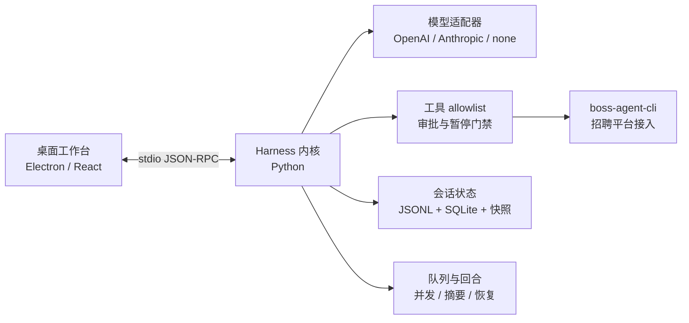

# BOSS-CLI

<p align="center">
  <strong>招聘垂直领域的 Agent Harness</strong><br>
  把可控的模型回合、招聘工具和可恢复会话放在同一个工作台里。
</p>

<p align="center">
  <a href="https://github.com/can4hou6joeng4/boss-cli/actions/workflows/build.yml"></a>
  <a href="https://github.com/can4hou6joeng4/boss-cli/issues"></a>
  <a href="https://github.com/can4hou6joeng4/boss-cli/pulls"></a>
  <a href="https://github.com/can4hou6joeng4/boss-cli"></a>
</p>

> **项目定位**：`boss-agent-cli` 负责招聘平台接入，BOSS-CLI 负责模型适配、执行循环、权限边界、会话状态和桌面交互。它借鉴 Pi 的 Agent Harness / Durable 设计思想，按本项目的招聘安全契约独立实现，不复制上游代码。

<p align="center">
  <a href="#快速开始">快速开始</a> ·
  <a href="#你会得到什么">能力地图</a> ·
  <a href="#交互式工作流">交互示例</a> ·
  <a href="#模型配置来源">模型配置</a> ·
  <a href="CONTRIBUTING.md">参与贡献</a> ·
  <a href="UPSTREAM.md">上游吸收记录</a>
</p>

## 按目标阅读

| 你想做什么 | 入口 |
| --- | --- |
| 在本机启动桌面工作台 | [快速开始](#快速开始) |
| 了解搜索、回合队列、摘要和技能 | [交互式工作流](#交互式工作流) |
| 配置 OpenAI 或 Anthropic 模型 | [模型配置来源](#模型配置来源) |
| 核对查询范围、平台访问和暂停条件 | [招聘工具与平台边界](#招聘工具与平台边界) |
| 理解模型预算、摘要和历史恢复 | [模型与长会话](#模型与长会话) |
| 接入自定义工具或参与开发 | [模块边界](#模块边界)、[贡献与验证](#贡献与验证) |

## 你会得到什么

| 你想解决的问题 | BOSS-CLI 的回答 |
| --- | --- |
| 让模型帮我查职位 | 结构化搜索参数、明确页码、保留分页事实，不自动扩大查询范围。 |
| 让模型继续做事 | 会话内串行工具、`steering`、`follow-up` 和可观察队列，状态可重启恢复。 |
| 不想重复执行招聘操作 | 工具调用有稳定身份、审批和结果未知边界；断连后不凭猜测重放外部副作用。 |
| 长会话越来越难控 | 上下文预算、冻结快照、手动摘要、来源切点和有界 JSONL 冷读。 |
| 希望换模型线路 | OpenAI Responses、Anthropic Messages 和 `none` 确定性模式共享同一内核契约。 |
| 想在桌面里操作 | Electron / React 工作台通过双向 stdio JSON-RPC 连接 Python 内核。 |

核心能力包括 14 个允许清单工具（13 个只读工具、1 个逐次审批的招聘者打招呼工具）、SQLite 索引与 append-only JSONL、事件回放、冻结快照、完整回合分支、技能上下文和重启恢复。能力发现不会自动增加工具权限；模型与普通 renderer 不接收平台 Cookie。



## 快速开始

使用 Node.js 24+、Python 3.12，桌面最低 macOS 12。内核声明支持 Python 3.10+，读取 TOML 配置需要 3.11+；当前验收环境为 macOS、Node 24 和 Python 3.12。

```sh
uv venv --python 3.12 .venv
uv pip install --python .venv/bin/python -e ./harness
npm ci
npx install-electron --no
npm run typecheck
npm run build
BOSS_HARNESS_PROVIDER=none npm run dev
```

启动后可以先在无模型模式体验交互：

1. 输入 `/tools` 查看当前 allowlist 能力。
2. 输入 `/search Python` 运行关键词快捷搜索。
3. 在模型模式下尝试“上海 Python，20–50K，3–5 年，本科，先看第一页”。
4. 在回合运行中发送一条 steering，或把新消息排成 follow-up，观察队列状态和回合边界。

`none` 模式不会调用模型，但 `/tools`、`/search` 等仍可能调用配置的 `boss-agent-cli`。第一次运行建议使用临时工作区和只读工具；真实模型请求可能联网并产生费用，招聘平台操作仍需用户明确授权。

<details>
<summary>展开：一次可控的交互路径</summary>

```text
用户：上海 Python，20–50K，3–5 年，本科，先看第一页
  ↓
模型：生成结构化 boss_search 参数
  ↓
Harness：校验城市、薪资、经验、学历、页码与工具权限
  ↓
boss-agent-cli：提交指定逻辑页，返回结果和分页事实
  ↓
桌面：显示来源编号；用户决定是否查看下一页、摘要或继续追问
```

读取列表不会自动回复、投递、导出简历或翻页；需要外部写操作时，内核会进入逐次审批和结果核对边界。
</details>

## 交互式工作流

### 1. 搜索：先给边界，再给结果

模型会把自然语言条件转换为结构化请求。每次只查询指定逻辑页，下一页需要保留全部条件并显式把 `page` 改为 `2`；`has_more=null` 仍表示未知，不会把本页数量当作全量结果。

```json
{
  "keyword": "Python",
  "city": "上海",
  "salary": "20-50K",
  "experience": "3-5年",
  "education": "本科",
  "page": 1
}
```

### 2. 回合：让消息进入正确的位置

| 操作 | 何时生效 | 失败时发生什么 |
| --- | --- | --- |
| 直接发送 | 空闲回合立即开始 | 输入是否已保存会明确返回，不从 `error` 猜测执行事实。 |
| `steering` | 当前工具批次结束、下一次模型请求前 | 取消或持久化失败时保留事实，不自动重放。 |
| `follow-up` | 当前回合自然结束后按 FIFO 派发 | 并发、摘要或结算失败会保持 `queued`/`paused`，不误报为已执行。 |

### 3. 上下文：可追溯地压缩，而不是删除历史

会话原始记录保留在 JSONL；模型看到的是经过摘要、编辑和预算校验的投影。手动摘要可生成、观察、取消，摘要来源切点、usage、checkpoint 和重启结果都可追溯。冻结快照用于读取一致的历史切面，不会让模型重新执行已经完成的工具。

### 4. 技能：只增加提示上下文，不增加权限

将技能放在 `.boss-cli/skills/<id>/SKILL.md`，在输入区选择后随单次直接发送提供上下文。目录发现最多返回 100 个可读取普通文件，每个文件最多 64 KiB；坏编码、超大文件、符号链接和 FIFO 会被跳过。技能内容不会执行目录脚本，也不会扩大 allowlist 或审批范围。

Electron 运行时从官方源单独下载和校验，失败后需先恢复安装再启动。`none` 模式不调用模型；使用 `/tools` 或 `/search 关键词` 时仍会调用配置的上游 CLI。

工具可执行文件按 `BOSS_CLI_BIN`、并排 `boss-agent-cli/.venv/bin/boss`、PATH 的顺序查找。`BOSS_CLI_DATA_DIR` 是上游登录及平台状态目录，`BOSS_CLI_HARNESS_DIR` 是本项目的会话目录，两者分别管理。

启动 Harness 或桌面应用前，可用 `BOSS_HARNESS_BROWSER_SOURCE` 覆盖业务 CLI 的浏览器来源：`auto`、`existing-browser` 或 `stored-cookie`。未设置时完整继承上游 `config.json`。显式覆盖只传递上游 `--browser-source` 参数，不读取或改写该共享配置；不支持该参数的 CLI 会明确失败，不自动去掉参数重试。连接设置页会显示当前覆盖值或“继承上游 CLI 配置”。

运行中的会话支持把新消息“转向当前回合”或“排到后续回合”。转向消息会在当前工具批次结束后、下一次模型请求前加入；后续消息等当前任务自然结束后再启动。停止任务仍是独立操作。队列显示持久状态，尚未投递的项目可以撤回；未知提交回执会保留原文并使用同一请求编号重试，不会自动重复排队。

后续回合在线程启动前失败时，队列暂停并显示“启动失败，未执行”，同时注明输入是否已保存在当前会话；无法核实时提示先核对。已保存输入保留，相同请求编号不会重复写入或执行。暂停项可撤回，核对后可明确发起新任务，不会自动重试。线程已经实际启动时，即使启动调用随后抛错，也继续由原 worker 完成执行和资源收尾。旧记录缺少失败关联信息时保持原状态，不推断可重试。

工具 handler 返回后若结果记录写入异常，内核先按原条目身份核对完整结果并有限重试，不会重新执行工具或复用审批。恢复到完整结果后会暂停当前批次和后续队列；若结果不能确认，保存 `outcome_unknown` 并要求先核对外部状态。连未知状态也无法确认时，该会话在当前进程内拒绝新的模型回合和排队请求，重启后由会话恢复流程核对，不自动重放工具。

同一会话内，直接发送和后续排队共用 `clientUserMessageId` 请求身份。相同编号与原始输入命中旧请求时，队列关联原回合，不新增输入或执行；“已投递”仅表示输入已被接受，不表示原回合成功。明确未启动的旧失败保留暂停，执行证据不足时提示核对，不从 `error` 推断未执行。尚未产生回合的排队、暂停或撤回请求不能通过直接发送绕过原状态；新任务应使用新编号。相同编号的不同输入、steering 类型冲突或历史身份歧义会明确拒绝。

从已结束回合创建分支时，只复制该边界内的历史与上下文，不继承原会话的执行队列。已投递的消息保留为普通历史，原会话队列保持不变。

宿主可通过 JSON-RPC `thread/delete({threadId})` 永久删除空闲会话。仍有回合、摘要、队列交接或清理 worker 持有的会话会以 `THREAD_BUSY` 拒绝；成功后发送不含会话正文的 `thread/deleted` 事件。删除覆盖会话记录、该会话的事件、SQLite 投影、应用管理的索引修复备份，以及未被其他会话引用的附件。历史分支是独立副本，会继续保留；已经发给模型、客户端或 hook 的数据、外部工具创建的文件与平台操作不会被撤销。此接口目前不在桌面 renderer 白名单中，也不提供桌面删除按钮。

删除使用可恢复的私有意图标记；清理中断时会话立即从读取、列表及事件回放中隐藏，内核启动时继续清理。该操作移除应用当前存储中的逻辑副本，不承诺覆盖 APFS/SSD 上的历史文件块，也不会清理 Time Machine、文件系统快照或用户自行复制的备份。

将运行时技能放在工作区 `.boss-cli/skills/<id>/SKILL.md` 中，可用 frontmatter 的 `name`、`description` 提供名称和说明。输入区“技能”菜单从内核加载目录，允许刷新或失败后重试；目录发现最多保留字典序前 100 个可读取的普通技能文件，单文件按 UTF-8 原始字节限制为 64 KiB，坏编码、超限文件、符号链接和非普通文件会被跳过，单个无效文件不会阻断其他技能。每次最多选择 10 项，随新会话首轮或已有会话的直接发送生效，成功转交后清空选择。技能作为该回合的提示上下文，不自动执行目录脚本，也不扩大工具允许清单或审批权限。运行中的队列消息暂不支持技能；有选择时会阻止排队并保留草稿，清除选择或等待回合结束后再发送。

默认桌面模型为 OpenAI Responses，可由 `BOSS_HARNESS_PROVIDER` 选择 `openai`、`anthropic` 或 `none`。OpenAI 配置读取本地 Codex 配置或 `BOSS_HARNESS_OPENAI_*` 环境变量；Anthropic 使用 `ANTHROPIC_*`。真实模型请求可能联网并产生费用。不要将凭据写入仓库或公开日志。

## 模型配置来源

桌面默认使用 OpenAI Responses，也支持 Anthropic Messages；`none` 模式可在不调用模型的情况下体验确定性入口。真实模型请求可能联网并产生费用。

<details>
<summary>展开：显式环境变量和本地 Codex 配置的读取规则</summary>

OpenAI Responses 的完整显式配置由以下三项组成，去除首尾空白后均须非空：

| 配置 | 来源 |
| --- | --- |
| 端点 | `BOSS_HARNESS_OPENAI_BASE_URL` |
| 凭据 | `BOSS_HARNESS_OPENAI_API_KEY` |
| 模型 | 命令行 `--model`，其次为 `BOSS_HARNESS_MODEL` |

三项齐备时不访问 Codex 配置文件，Python 3.10 也可使用这一路线；可选推理强度只取 `BOSS_HARNESS_EFFORT`，未指定则由模型服务决定，不再继承文件中的值。没有 `BOSS_HARNESS_OPENAI_MODEL` 别名。

缺少任一项时才读取 `BOSS_HARNESS_CODEX_CONFIG`、`CODEX_HOME/config.toml` 或默认 `~/.codex/config.toml`，按此顺序选择文件，显式字段仍优先。读取 TOML 需要 Python 3.11+；已有文件不可读或语法损坏时明确报错，不退到其他 provider。文件不存在或缺少可用 profile 时继续检查端点与凭据，缺项会报错；未提供模型且没有可用文件模型时保留既有 `DEFAULT_MODEL`。

当前文件适配要求文件自身同时提供 `model`、`model_provider` 及该 provider 的 `base_url` 才形成可用 profile；认证仅识别 `experimental_bearer_token`，尚未适配 Codex 的 `env_key`、OAuth 或任意 `wire_api`。配置解析只读本地文件，不探测真实服务。

</details>

## 招聘工具与平台边界

搜索与沟通工具按明确条件和指定页工作。未知分页、筛选结果或沟通状态会保留为未知；读取不会隐式扩大查询范围或执行回复、投递等外部操作。

<details>
<summary>展开：搜索参数与沟通列表的完整契约</summary>

### 明确条件搜索

在模型会话中可以要求“上海 Python、20–50K、3–5 年、本科，先看第一页”，模型通过 `boss_search` 传递结构化条件：

```json
{"keyword":"Python","city":"上海","salary":"20-50K","experience":"3-5年","education":"本科","page":1}
```

随后查看第二页时保持全部条件，只把 `page` 改为 `2`。工具不会自动拉取下一页，也不会自动放宽条件或逐个补取详情。平台返回 `has_more=null` 或没有分页信息时，是否还有后续结果仍未知；本页数量不能当作全量总数。

城市及岗位标签受当前适配契约的枚举约束，可通过 `tool/list` 查看。未知城市、标签、额外字段或非正整数页码在执行前被拒绝；旧 CLI 不支持新选项时保留明确错误，不去掉条件重查。平台标签与上游本地预筛不构成严格资格证明：经验、学历或薪资字段未知时须注明未知，再结合职位原始要求分析。

经验、学历也接受非空、无重复的枚举数组，例如“3–5 年或 5–10 年，本科或硕士”：

```json
{"keyword":"Python","city":"上海","experience":["3-5年","5-10年"],"education":["本科","硕士"],"page":1}
```

数组表示同一维度的任一标签，两个维度同时提交到一次指定页查询；不拆成组合搜索。传给业务 CLI 时按固定枚举顺序生成单个逗号参数，原始数组留在会话记录中。空数组、重复/未知标签、混合类型及逗号字符串均拒绝；省略字段才表示不设条件。下一页重复全部条件，仅改页码。城市、薪资仍只接受单标签。

多标签依赖平台筛选；当前业务上游对逗号经验/学历不执行单标签顺序粗筛。离线验证只能证明参数传递，不能证明平台严格返回集合内结果；须核对返回字段并标注未知或不匹配项。一次调用至多查询指定逻辑列表页，不补详情；缓存命中可能不发列表请求。网络尝试、认证及缓存维护仍由业务 CLI 决定，不能按工具调用次数推算网络请求量。

仅传 `keyword` 的旧调用继续有效，由上游默认读取第 1 页。无模型模式的 `/search 关键词` 仍为关键词查询快捷入口，不解析结构化筛选标志。URL、薪资多选及更多列表筛选是后续扩展范围。

### 求职者沟通列表

配置模型后，可要求“查看求职沟通的第 1 页”或明确查询下一页。模型工具 `boss_chat` 只接受可选正整数 `page`，默认 1；一次提交指定逻辑页，不补取消息、不回复、不导出，也不自动翻页。无模型模式尚无 `/chat` 快捷命令。

例如工具参数 `{"page":2}` 读取第 2 页；读取列表不改变角色、凭据或浏览器来源，当前业务上下文仍由用户配置决定，不能视为账号身份核验。列表标识、文本和上游建议命令不增加工具权限。

固定业务版本返回 `pagination=null`，表示后续页未知；空列表和条数不能证明查询结束。上游可能把缺失/null/真实零未读数都输出为 `unread=0`，把缺失最近消息输出为 `last_msg="-"`；这些值不能证明已读或没有消息。`initiated_by` 是关系发起方，非最近发言方；`msg_status` 也不是已核实的阅读状态，不能据此判断“待我回复”。工具保留来源值，不补造已丢失的事实。

请求、认证及本地状态维护沿用业务 CLI，无法保证单次网络访问或首次限制即停；收到最终受支持停止码后暂停当前回合，不执行同批后续工具或自动模型续跑。恢复会话只读取历史，不自动重查；处理限制后由用户明确发起后续任务。

</details>

## 平台访问与执行边界

Harness 管理工具准入、结果持久化和可观察的停止信号；实际网络尝试、认证刷新与缓存由所配置的业务 CLI 管理。只有内核能够识别的终态错误或结构化停止信息才会触发暂停。

<details>
<summary>展开：认证、部分结果、输出限制与回合终止细节</summary>

### 业务 CLI 请求与认证边界

本项目按工具契约派发一次业务 CLI 进程调用，不自动展开组合或追加页面；其中的网络尝试、认证刷新、缓存及摘要补取由所配置的业务 CLI 决定。“只读”描述招聘业务动作，不表示单次网络请求，也不表示不维护本地状态。

每个业务 CLI 子进程的 stdout 与 stderr 合计最多读取 16 MiB 原始字节，包含空白和诊断输出。超过上限会停止进程组并返回 `CLI_OUTPUT_LIMIT`，不解析或保存残缺信封、不自动重试；当前回合、同批后续工具及后续队列暂停。若写操作已经派发，其结果记为未知，须先核对实际状态。通过持久记录预算的结果完整保存，再沿用大结果引用和分段读取；这不是截断成功模式，也不是平台请求次数限制。

会话 JSONL 正文与冻结快照的单条记录上限统一为 32 MiB；会话头和事件日志仍为 8 MiB。预算按最终序列化的 UTF-8 JSON 字节计算，不含行分隔符；追加、新会话/分支与摘要 checkpoint 均在写入或创建发布候选前校验，避免写出内核无法重读的记录。CLI 原始输出与持久记录各自计量，数值规范化、JSON 转义或元数据复制可能扩大记录；16 MiB 内的 CLI 输出不保证能通过 32 MiB 记录预算。超限工具结果不会被截断为成功，也不会写入超限行；原操作不重放，按既有结果持久化失败路径暂停并要求人工核对。该限制不约束序列化前的宿主对象内存。新的合法大记录超过旧内核的 8 MiB 读取上限，使用这些会话需保留兼容的新内核。

已核验的业务 commit `bdc7034df563f1ea458d3af5bb4b40e8ea4603a8` 中，部分只读 HTTP 请求在默认路径下可因限流冷却或明确 token 过期而重试，最多 3 次重试、共 4 次尝试；认证刷新还可能使用浏览器并保存凭据。这个数值只属于该固定路径，不是每个工具的总请求预算。最终成功信封不会披露此前被重试的停止事件。该来源是开放 PR #479 的 head，并非已发布兼容基线；更换 `BOSS_CLI_BIN`、版本或上游配置后须重新核验。

Harness 只能在 CLI 返回的最终错误或受支持的部分结果停止元数据可见时暂停；中断、外层超时和进程组清理不能保证在不可见的第一次限制响应后精确停止。成功结果也不能证明此次未发生限流、认证过期或刷新。模型不得据此报告“首次限流即停止”或“没有触碰浏览器”。

Harness 可通过进程环境变量 `BOSS_HARNESS_BROWSER_SOURCE` 显式传递上游支持的来源：`auto` 保留上游默认自动选择，可能探测 CDP 或降级到 headless；`existing-browser` 只复用现有 CDP 浏览器且不读取存储凭据；`stored-cookie` 使用上游存储凭据并只连接显式配置的 CDP，不自动探测或启动浏览器。后二者会改变请求通道和运行前提，不能视为“无重试”或“零平台访问”模式。未设置变量时不添加参数，继续继承上游 `config.json`；显式参数被上游拒绝时只失败一次，不静默删参或重放。该参数只对支持它的业务 CLI 有效，更换 `BOSS_CLI_BIN` 后须重新核验。

该覆盖不会读取 Chrome Cookie 数据库或 Keychain，也不修改共享上游配置；但 `auto` 仍允许上游的浏览器行为。Harness 无法约束忽略或误解该选项的任意二进制，也不能保证上游不会通过其他路径访问本地状态。浏览器来源策略不替代独立的请求预算、首次限流停止或认证刷新契约；若需要这些保证，仍须使用明确支持并验证相应行为的上游版本。

固定调用链、可观察范围及后续能力接入条件见 [UPSTREAM.md](UPSTREAM.md)。

### 平台暂停与聊天部分结果

`boss_hr_chat` 读取本页沟通列表时，业务 CLI 还可能为会话补取最近消息；列表只读不等于只有一个网络请求。默认摘要预算及补取行为沿用业务 CLI，本项目不追加补批或探测。

如果列表已取得、最近消息补取遇到认证、验证码、风控或限流停止码，工具保留已取得的 `data`、原始 `hints` 及分页，但以本地失败结果明确标记“部分结果，平台要求暂停”。收到这一可见停止信号后，当前回合暂停，同批后续工具不执行，也不再自动请求模型；列表不等于完整最近消息，未知未读状态不能当成已读。

适配仅识别 `hr chat` / `recruiter-chat` 的固定元数据 `hints.summary_sources.last_messages_error_code` 及既有停止码，不从候选人文本、任意错误字符串或其他命令推断授权和状态。原始 CLI 信封保留在适配对象的 `raw` 中，仍反映上游成功；会话与桌面保存、展示的是本地失败状态及部分结果。原有顶层失败保持原错误，普通成功和非停止摘要错误保持既有行为。

用户处理平台限制后再明确发起后续任务。恢复会话不会自动重试、补取消息、翻页或探测状态；上游 `hints` 中的建议命令仅作为来源数据，不构成执行授权。

### 模型截断与回合上限

OpenAI Responses 的 `response.completed` / `response.incomplete` 与 Anthropic 的 `message_stop` 都是响应终态；SDK 在终态后若继续交付任何流事件，内核按协议错误结束本次请求，不执行该响应的工具、不重试或继续后续队列，已接收的有界文本前缀标为失败保留。SSE 注释与 OpenAI 的 `[DONE]` 由 SDK 处理，不属于这些内容事件。

模型输出达到长度上限时，本次响应中的工具全部记为未执行，截断文本保留并以错误收尾，不自动重试或启动后续队列。每次模型响应的工具参数文本按原始 UTF-8 字节计数，每项及所有工具合计均最多 1 MiB；已解码的初始对象先检查结构和紧凑 JSON 字节数，再序列化。空白、转义及多个工具合计会触发这一新增边界，即使各项规范化 JSON 未超限。超限时关闭模型流并以错误结束，不保存超限参数、不调用 handler 或审批。该限制作用于 provider 已收到的事件，不能限制单个 HTTP/SSE 事件帧在解码前的内存，也不是进程 RSS 上限。文本与思考另按每次响应合计 1 MiB 原始 UTF-8 字节限制，增量和权威终态都在缓冲、事件持久化及通知前检查。超限以错误终止整轮，关闭流、不审批或执行该响应的工具、不重试或自动继续队列；已接收的有界前缀标为失败保留。增量事件拆为最多 32 KiB UTF-8，以便事件分页恢复；最终实时通知保留预算内全文，最坏 JSON 字符串转义仍在 8 MiB 帧限制内。该保证不包含 provider 附加元数据、无限事件数量或 SDK 解码单个 SSE 帧的内存。

每回合默认最多 6 次业务模型请求；启动环境变量 `BOSS_HARNESS_MAX_MODEL_REQUESTS` 可设为 1–64 的十进制整数，嵌入方可传入 `ApplicationService(max_model_requests=...)` 显式指定并覆盖环境配置。`config/read.maxModelRequests` 返回宿主上限；`turn/start.maxModelRequests` 只可为本回合收紧，必须是 1 到宿主上限的整数，不修改后续回合或队列默认值。非法配置在预留回合、保存输入或创建该回合 provider 前拒绝，布尔值、字符串和小数不作为 RPC 整数接受。

每个工具回路、steering 续答和上下文溢出恢复重试均计入本回合上限；provider/SDK 内部传输重试不在此计数中，摘要仍使用独立的 32 次生成上限。最后一次工具批次后仍需续答时，以 `blocked / TURN_ROUND_LIMIT` 暂停并保留结果，需核对后明确发起新回合；通知带 `maxModelRequests` 和 `modelRequestCount`，回合历史记录实际上限。最后一次正常最终文本仍可完成，最后到达而未能响应的 steering 保留为暂停队列项；已执行工具和审批不会重放。

</details>

## 模型与长会话

每次模型请求都会核对完整输入预算。长会话可通过完整回合摘要、上下文编辑和分段读取来管理；原始历史与已执行工具事实仍保留，超限或来源不一致时会明确暂停。

<details>
<summary>展开：模型容量、自动压缩、上下文编辑与会话恢复</summary>

### 模型容量与请求预算

内核在每次模型请求前估算完整输入，包括 system/技能、用户材料、消息与思考、工具调用及结果、工具 schema 和请求选项。输出预留受模型声明的上限约束，输入增长不会静默缩小输出；保留 4096 token 安全余量。接近或超过预算时可先自动摘要更早的完整回合；仍无法容纳时以 `blocked / CONTEXT_BUDGET_EXCEEDED` 或明确的压缩错误暂停，不请求业务模型、不自动启动后续队列，已有工具结果继续保留。steering 只有在下一请求通过预算检查后才标记已投递；预算失败时保留为暂停项。

通过启动环境变量 `BOSS_HARNESS_MODEL_LIMITS` 配置精确的 `provider/model` 容量，例如：

```sh
export BOSS_HARNESS_MODEL_LIMITS='{"openai/custom-model":{"contextWindow":128000,"maxOutputTokens":16000,"reasoningEfforts":["low","medium","high"]}}'
```

键中的 provider 使用 `anthropic`、`openai` 或 `none`（`codex` 线路解析为 `openai`）；模型名精确匹配且可含 `/`。两个容量均为整数，窗口须大于 4096，输出上限须为不超过窗口的正数。可选 `reasoningEfforts` 只接受 `none`、`minimal`、`low`、`medium`、`high`、`xhigh`、`max` 的非重复数组；省略时表示该模型没有可供会话选择的已声明档位，不会猜测供应商能力。配置最多 128 项、UTF-8 编码 64 KiB，拒绝重复键、未知字段、布尔值和无效类型；错误不显示原配置。嵌入方可显式传入不可变 `ModelCatalog`，不读取该环境变量。

未知模型使用 200000/64000 的兼容预算，返回 `capabilitySource=legacy-default`、`capacityIsEstimate=true`；这是本地假设，不能证明真实服务容量。请求输出大于此默认上限时会裁剪到 64000，需要更高额度时应显式配置。显式容量标记为 `configured`，仍由部署者核对模型及网关约束，不自动探测或下载模型目录。

`context/read` 传 `threadId` 可查看完整预算；空闲时还可传与下一回合一致的 `model`、`input`、`skillIds`、`attachmentIds` 做预览。运行中返回当前已准备请求的快照，并拒绝预览参数。`requestSource` 区分 `active`、`preview`、`default`；准备完成前的 `active` 是按当前回合配置生成的候选预算。`summaryAvailable` 表示当前摘要策略有非 `none` 线路且宿主提供了独立 provider factory。`requestedOutputTokens` 保留原请求值，`outputReserve` 是裁剪后的值；`breakdown` 分列 system/messages/tools/options。每次请求记录预算，重启后 `lastBudget` 可追溯最后一次准入或拒绝，读取不会执行模型或工具。

会话菜单可通过 `thread/reasoning/read` 读取模型声明的推理档位，并用 `thread/reasoning/set` 保存当前会话选择；传 `null` 恢复启动配置。设置追加到会话历史，不修改环境变量或 Codex profile；会话分支继承创建时的设置。设置在下一次请求准备边界生效，已经准备或正在传输的请求保持原档位。业务回合与上下文预算使用当前会话的有效档位；摘要默认继承该档位，显式设置摘要 effort 后则使用独立档位。当活动模型与摘要模型的能力集合不一致时，只显示两者交集，避免档位设置使业务回合无法执行。重启后若部署的能力表移除了已保存档位，读取会标记为不受支持，用户可恢复继承配置。

token 数默认采用 `characters/2+message-overhead` 分类估算，不是供应商 tokenizer 或计费值。成功 usage 的 provider、模型和完整请求前缀匹配时，使用 usage 基线和新增尾部估算，返回 `usageApplied=true`；否则回退到字符估算。模型摘要使用独立 provider，不带招聘工具，支持取消和分段进度；可显式启动或在业务请求边界自动生成。来源及兼容差异见 [内核建设记录](UPSTREAM.md)。

用户主动触发的模型连接检查也应用同一容量约束，其最多 512 token 的诊断请求会按模型输出上限裁剪；预算不足在构造供应商前返回检查失败。诊断不属于会话回合，不写入会话预算历史。

关闭内核时，应用先冻结准入，并为业务回合、摘要任务和连接检查统一置位取消，再异步分发各自的中止。所有 worker 与 abort 共享同一个最多两秒的等待期限；尚在检查中的模型诊断以 `failed / CANCELLED` 收尾，已经超时的检查保留 `CHECK_TIMEOUT`。不可协作的 provider 可能稍后才退出，取消不能保证强制终止 SDK 建连；尚未退出或仍在发布终态通知的任务继续保留 provider、bridge 与状态目录所有权，旧超时回调、迟到响应和异常不会覆盖新检查或既有终态。关闭期间工厂才返回的实例不会开始模型请求。

连接检查和官方登录保存任务在 worker 构造或实际启动前失败时返回固定失败状态并释放槽位；登录返回 `LOGIN_SAVE_START_FAILED`，需要重新打开官方登录窗口，不自动重试保存。若启动包装层在 worker 已实际启动后抛错，内核继续跟踪原任务和取消信号，直至 worker 与已启动的模型 abort 完成清理；不会据此重复检查或保存登录态。桥接工厂、本机可用性及认证检查返回后，已观察到取消的任务不再发起后续 CLI 调用。

`turn/interrupt` 和 `context/compact/abort` 返回的是取消请求确认，不表示 worker 或供应商连接已经退出。应用先设置相关取消信号，再异步分发业务与摘要各自的中止，慢 hook 不占用 RPC 处理线程或全局运行锁；中断自动摘要所属回合时，两者都先收到取消。重复取消及随后关闭共用同一次中止，实际完成状态以回合/摘要终态及收尾为准。直接嵌入使用 `TurnRunner.interrupt()` 的同步接口保持原有约定。

回合终态提交与取消接受使用同一运行锁边界。终态提交前已接受的取消以 `interrupted` 收尾，并暂停结算时已排入的后续队列；即使模型已经给出完成结果，也不会继续自动派发。已产生的文本、工具结果、审批及外部动作事实仍保留，取消不表示撤销。终态已提交并释放执行槽位后，若没有活动回合则返回未中断；旧 `turnId` 不能中断新回合。用户之后仍可显式发起新任务，已暂停的队列不会因此自动恢复。

回合最终 `finish` 阶段 checkpoint 无法确认持久化时，当前执行以 `error` 收尾，尽力追加 `phasePersistenceFailure` 修正记录，并在释放容量前暂停当前会话全部待处理队列。暂停写入也失败时，内核保留暂停责任；后续准入或领取必须先完成暂停，存储恢复不会自动执行旧 follow-up。其他会话仍可按既有 FIFO 等待顺序取得空出的容量。

### 自动压缩与溢出恢复

模型回合默认开启自动压缩：完整输入估算达到 `inputBudget` 的 80%，或预算检查拒绝请求时，尝试摘要更早的完整回合，保留近期估算 20000 token。`inputBudget` 已扣除业务输出储备和 4096 token 安全余量，阈值不重复扣减。小窗口应降低保留目标；当前运行回合始终完整保留，因此单个过大输入或工具结果仍可能无法容纳。

启动配置 `BOSS_HARNESS_COMPACTION` 接受 JSON 对象，例如 `{"enabled":true,"triggerPercent":80,"keepRecentTokens":4000,"provider":"openai","model":"summary-model","effort":"low"}`；可省略字段，其余使用默认值。`enabled` 为布尔值，`triggerPercent` 为 1–100 整数，`keepRecentTokens` 为 1–1000000 整数；`provider` 可为 `anthropic`、`openai` 或 `codex`，`model` 是本机线路上的模型 ID，`effort` 只能使用 `none`、`minimal`、`low`、`medium`、`high`、`xhigh`、`max`。显式 effort 必须在 `BOSS_HARNESS_MODEL_LIMITS` 中为摘要模型声明支持；未声明时拒绝开始摘要。拒绝未知字段、重复键和无效类型，错误不显示原配置。`config/read` 返回解析后的 `autoCompaction`，摘要任务与 checkpoint 记录实际 `summaryProvider`、`summaryModel` 和 `summaryEffort`。嵌入方可传入不可变 `CompactionPolicy`；不传时才读取环境变量。

单次 `turn/start` 可通过 `autoCompaction` 部分覆盖触发策略，例如 `{"threadId":"…","input":"继续分析","autoCompaction":{"enabled":false}}`。覆盖仅适用于该回合，不修改会话或全局默认值；摘要的 provider/model/effort 仍使用启动时的独立摘要配置。未设置摘要配置时继续沿用当前会话模型与推理档位；可显式指定不同摘要线路或档位，模型容量、输入预算和 4096 安全余量按摘要模型计算。摘要完成后，checkpoint 仍须通过当前业务模型的完整请求预算校验才会提交。模型路线必须是本机可配置线路，要求 provider factory 创建与业务回合隔离的实例；嵌入方未提供工厂时不执行可选自动摘要，预算超限仍暂停。

自动摘要复用分段生成、来源 digest 和单次提交机制，只替换核对一致的历史前缀。当前回合的用户材料、思考、工具调用及结果、已交付与暂存 steering 保持原对象和顺序；摘要成功后、业务请求前再领取一次新 steering 并重检预算。每个业务请求边界最多启动一次阈值/预算摘要，因此工具返回新结果后会重新检查；超过窗口的恢复另有每回合一次上限。没有可摘要前缀但请求仍在预算内时继续，已启动摘要失败则暂停。任务通过同一压缩任务接口和通知报告进度，`reason` 为 `threshold`、`budget` 或 `overflow`，并附所属 `turnId`。中断回合或取消自动摘要都会停止该回合及独立摘要流；已成功提交的 checkpoint 保留，取消后不再请求业务模型。

实际供应商窗口小于本地容量时，仅在 OpenAI 可信错误字段精确返回 `context_length_exceeded`，OpenAI-compatible llama.cpp 返回有界且精确的 `Context size has been exceeded.`，OpenAI-compatible LiteLLM 的 HTTP 400 错误消息有界且同时包含 `litellm.ContextWindowExceededError`、`Context Window exceeded for given call.` 和 `Got > Max Input Tokens`，或 Anthropic 返回类型明确且包含数字上下限的 `prompt is too long` 错误时标记 `CONTEXT_OVERFLOW`。OpenAI 与 Anthropic 的可信 HTTP 413 还接受不超过 512 字符、完整匹配 `Request body too large` 或 `payload too large` 的消息（忽略大小写，可带末尾句点），以处理代理在 token 窗口内按请求字节数拒绝的情况。当前请求未产生任何文本、思考或工具事件且未取消，才允许本回合最多一次压缩后重试；失败请求与重试都计入本回合业务模型请求上限，最后一次失败不再摘要。只继续当前请求，不重新运行已执行工具或复用旧审批。裸 HTTP 413、其他 413 消息、输出 `length`、限流、认证、连接错误、任意其他错误文字或超窗 usage 均不触发此恢复；旧 provider 没有结构化分类时保持普通失败。

供应商终态模型错误会把有界 `errorInfo` 附加到 `session/error` 并保存在 `model_error` 记录中，字段包括 provider、错误来源、可用 HTTP 状态、经过字符集与长度筛选的 provider code，以及可选 `retryable`。OpenAI 流内错误的 HTTP 状态记录为 200；缺少状态或明确分类时省略对应字段。另有 `outputObserved` 标记请求是否已向调用方输出文本、思考或工具增量。`retryable` 描述 provider 请求级错误分类，不代表整回合可以重放；现有 OpenAI 内部重试行为不变，Anthropic 不新增重试。只有上文列出的精确 `CONTEXT_OVERFLOW` 条件能触发上下文恢复；状态码或 `retryable` 不会改变审批、工具派发或回合恢复策略。错误记录不包含响应正文、请求、响应头或凭据；明确的额度耗尽 code 标记为不可重试，只有已知的临时限流/服务端错误才标记可重试，含义不明的 HTTP 429 保持未知。

摘要请求自身或连接诊断不会进入业务溢出恢复。自动任务由当前业务 worker 持有，重启只恢复历史，不自动重放摘要、业务请求或外部操作。全局自动策略编辑仍通过配置和协议控制。

### 桌面上下文与手动摘要

在真实会话中打开“上下文”，查看内核返回的当前会话或活动请求预算，包括估算输入、有效输入预算、输出预留、容量来源及 usage 校准依据。该读取不包含尚未发送的草稿、技能或附件；token 数不是精确 tokenizer 结果或账单。打开面板、刷新预算和规划均不调用模型或招聘工具，也不会停止当前任务。

会话空闲时可设置保留近期上下文的估算 token 目标，先读取计划，核对整理的历史范围与保留的完整回合，再显式生成摘要。摘要默认沿用当前会话模型，也可通过 `BOSS_HARNESS_COMPACTION` 配置独立 provider、model 和 effort；手动摘要请求中的 `model` 可覆盖启动时设置的摘要模型。摘要可能增加用量；计划来源 digest 与选定范围一同提交，过期时需要重新核对，不移除校验自动重试。摘要仍保留原始历史，不能保证语义无损，也不会执行招聘工具或重复既有审批。

面板按会话与任务 ID 展示分段进度、取消确认及终态。取消受理不表示 worker 和模型连接已经退出；终态之后也可能仍在收尾。完成后重新读取预算和 checkpoint，不从字符进度推断成功。运行中的自动摘要由所属业务回合控制，不因打开面板而被取消。

`context/read.compactionJob` 是可选任务引用，包含 `jobId`、`status`、`active`；`active=true` 表示当前进程仍持有会话执行责任，可能与终态同时出现。最近保留的终态任务从持久事件日志重建，详情继续通过 `context/compact/read` 核对；嵌套的 `job.result` 是历史快照，不能代表当前收尾状态。旧服务缺少字段表示无法发现，`null` 表示当前没有保留的任务。

切换会话、关闭面板、断连或开始回执未知时不会自动再次生成摘要；已知任务通过读取对账。进程重启后，未终结任务会检查对应 `summaryJobId` 是否已写入 checkpoint：已提交的恢复为 completed，否则恢复为 `failed / COMPACTION_INTERRUPTED`。恢复只补写可观察终态，不恢复 provider 请求或 checkpoint；用户须重新读取计划并显式开始新任务。最近 64 条终态可查询，之后被淘汰的旧任务可能无法查询。

### 大结果与会话恢复

模型可见工具结果按工具定义的 `max_model_result_bytes` 限制，默认 20 KiB，允许范围为 8 KiB 至 1 MiB。较大结果在模型上下文中显示明确的省略标记、摘要和结果 SHA-256；完整结构化结果继续保存在会话记录中。Harness 提供只读内核工具 `read_session_tool_result`，模型可按 item ID、摘要和游标每次读取至多 8,192 个 Unicode 字符；读取只访问当前会话已保存的数据，不重新调用招聘工具。桌面/RPC 展示仍使用独立的结果引用：超过 64 KiB 时不内联传输，客户端可通过 `thread/item/result/read` 按需分段读取，默认 16,384、最多 32,768 个 Unicode 字符。

RPC 客户端可通过 `thread/item/result/read`，传入 `threadId`、`itemId`、引用中的 `sha256` 及可选 `cursor`、`limit` 读取标准 JSON 文本；默认 16,384、最多 32,768 个 Unicode 码点。引用包含该文本的 UTF-8 SHA-256、字节数和码点数，服务端游标绑定会话、条目及版本。结果发生修订时返回 `STALE_RESULT`，客户端须重新获取并确认引用，不能混用不同版本。

超过 64 KiB 的 Agent 文本与思考字段在条目读取和持久完成事件中改为 `textRef` / `thinkingRef`，原文仍保留在会话。`thread/item/content/read` 按 `part`（`text` 或 `thinking`）、会话、条目及 SHA-256 读取，默认 16,384、最多 32,768 个 Unicode 码点；游标绑定字段与内容版本，变更返回 `STALE_CONTENT`。冻结快照的引用还绑定 `snapshotId`，在快照有效期内始终读取该版本。桌面恢复时逐段校验长度与摘要，再展示快照；每个历史字段自动恢复上限为 16 MiB，超过时明确报错，原文仍可由该接口分段读取。恢复失败不重放招聘动作。新方法保持协议版本 `0.2.0`；自定义客户端需支持内容引用，才能完整恢复大字段。

会话条目和事件回放还按约 1 MiB 响应预算分页，游标只推进到实际返回的数据。非分页读取或单条记录无法传输时会返回明确的 `RESPONSE_TOO_LARGE` 错误，连接继续可用；支持快照的客户端应通过 `thread/resume` 的冻结分页恢复。原始记录不被裁剪，读取不触发招聘工具。

</details>

## 模块边界

| 路径 | 职责 |
| --- | --- |
| `apps/desktop` | Electron 主进程、preload 和 React 工作台 |
| `packages/protocol` | JSON-RPC、会话条目及通知契约 |
| `packages/app-client` | 进程连接、双向请求、握手、超时及重连 |
| `harness/src/boss_harness` | 执行、上下文、持久化、恢复和模型接入 |
| `harness/src/boss_harness/tools` | 招聘提示、工具契约、CLI 适配及平台暂停规则 |

## 嵌入式扩展

桌面端使用默认招聘工具组合；Python 宿主也可以注入自定义工具、provider 和生命周期策略。自定义扩展由宿主显式提供，不会从工作区自动发现或获得招聘平台权限。

<details>
<summary>展开：工具组合、生命周期 hook 与并发所有权</summary>

### 显式工具组合

内嵌 Python 应用可通过 `ToolDefinition`、`ToolBundle` 与 `ApplicationService(tool_bundle=..., bridge_factory=...)` 组合工具。每个定义固定工具名、描述、对象 schema、handler 和是否逐次审批；注册表提供不可变的 handler/审批快照，以及只读 schema 投影。`requires_approval` 是安全分类：任何有外部或持久副作用的工具都必须设为 `True`。Bridge 工厂每次须返回独立、可弱引用且支持 `cancel_event` 的实例；应用会拒绝仍存活的重复实例。Bridge 可提供同步且应快速返回的 `close()`，或以 `dispose()` 作为兜底；临时运行器、连接检查和应用级实例分别由其所有者在工作结束或关闭时释放，重复关闭不会再次调用钩子。清理异常不会改写任务结果。

默认招聘工具组合支持 `ApplicationService(prompt_preamble="...")` 只替换系统提示的身份段，默认工具说明、招聘规则、技能和只读限制仍由内核组装；默认路径仍启用平台连接检查及官方登录 host API。身份文本只接受非空、无控制字符且不超过 16 KiB 的 UTF-8 文本，不写入会话或事件。自定义 `ToolBundle` 的任意完整 `system_prompt` 没有可推断的分段，和 `prompt_preamble` 同时传入会明确拒绝；需要完全自定义提示时应自行提供完整 bundle。

嵌入方可向 `ApplicationService(lifecycle_hooks=[...])` 显式注入宿主策略对象。`on_event(context)` 在持久事件落库后按序异步接收有界投影，不含消息正文、思考、工具参数或结果；队列容量为 256，拥塞会记录 `kernel/hookError`。每个 `LifecycleHooks` 实例中所有 hook callback 合计最多 16 个在途 worker；名额在 callback 实际退出后释放，超时不会取消线程。容量满时观察回调会被跳过并按每秒最多一次合并诊断，关闭时刷新剩余汇总；持久事件仍正常处理。策略回调容量满时返回 `HOOK_BUSY` 并 fail closed。`before_tool_call(context)` 在 schema 校验后、审批和 handler 之前运行，可返回 `HookDecision(False, code, message)` 拒绝本次工具并暂停回合。策略收到与已验证工具参数一致的完整深只读 JSON 快照，不做事件观察所用的脱敏或截断；紧凑 JSON 以 UTF-8 编码后的总量上限为 1,052,672 字节，另受 32,784 个节点、深度 66 限制，超限或非 JSON 输入会在策略回调前 fail closed。返回允许、抛错、返回无效值或超时都不能跳过原有逐次审批，策略检查异常按拒绝处理。回调运行在独立 daemon worker 上，默认限时 250ms，宿主可传入 `hook_timeout`（最大 30 秒）；超时回调的迟到返回不会改写回合。hook 由宿主代码直接注入，不扫描或导入工作区文件，也不提供进程沙箱；嵌入方须把它视作可信代码。关闭时内核先收尾 worker，再在共享关闭期限内等待事件观察并调用 hook 的 `close()`。

`before_tool_call(context)` 保持旧的一参数形式兼容；需要协作取消的宿主可改为 `before_tool_call(context, *, signal)`，其中 `signal.aborted` 表示回合已取消，`signal.wait(timeout)` 可等待该状态。取消会结束内核的策略等待并忽略迟到决策；如果 hook 不检查 signal，它的 Python 线程仍会继续运行并占用在途名额直到退出，因此策略 hook 应保持无副作用并在可取消工作点检查 signal。取消接受与工具派发认领通过同一运行时锁排序：若取消先于派发认领，当前工具记录为 `CANCELLED / not_executed`，handler 不会被调用；此前已发出的审批请求不会撤回。若派发认领先发生，操作已被派发，handler 可能即将开始或已经开始，中断不能保证阻止该操作或撤销其副作用。

`before_request(context)` 同样兼容一参数和可选 `signal` 形式，在业务模型请求、每个摘要分片和模型连接检查的完整请求预算准备后、provider 调用前统一执行。`purpose` 分别为 `turn`、`compaction`、`connection_check`，`requestIndex` 从 0 开始，按对应回合、摘要任务或连接检查计数；上下文还包含 provider/model、消息与工具数量及预算快照，以及适用的 `threadId`、`turnId`、`jobId` 和业务请求上限，不包含消息正文、工具参数或凭据。策略不能改写请求；provider/SDK 内部的传输重试不重复经过此闸门。

自定义 provider 的 `stream(request)` 可读取 `request.task_context`，类型为从 `boss_harness.models` 导出的不可变 `ModelTaskContext`。它与上述策略检查使用同一请求身份，字段为 `purpose`、从零开始的 `request_index` 及可选 `thread_id`、`turn_id`、`job_id`；完整请求准备后由执行 owner 绑定，preparer 重建请求也不会丢失或改变归属。自动摘要沿用创建该任务时的回合 ID，每个分片独立编号；手动摘要的 `turn_id` 和连接检查的三个 ID 保持 `None`，不借用最近或正在运行的回合。直接构造 `ModelRequest` 时 `task_context` 默认为 `None`，旧 provider 可继续忽略该字段。

任务上下文只供本地嵌入方路由和关联请求使用；任务 ID 不能证明用户身份或计费归属。内置 OpenAI / Anthropic provider 不把它写入模型消息、HTTP metadata、预算或请求指纹，供应商内部传输重试沿用原上下文，不增加一次逻辑请求计数。

`after_tool_call(context, *, signal)` 在工具终态已持久化后、回合继续向模型请求前同步调用，覆盖成功、失败、拒绝、未执行和可确认的结果未知终态；即使回合已取消也会启动观察回调，并以 `signal.aborted=true` 告知宿主，内核可停止等待并记录 `kernel/hookError`。超时、异常、容量耗尽或取消都不改写工具事实，也不会重跑工具或审批。默认上下文只包含会话/回合/条目标识、工具名、状态、执行状态和错误码。要读取完整结构化结果，须显式使用 `ApplicationService(..., expose_tool_results_to_hooks=True)`，或构造 `LifecycleHooks(..., expose_tool_results=True)`；该结果可能含候选人个人信息。回调收到深只读快照且返回值被忽略，不能修改持久化结果或模型可见结果。若传入预构造的 `LifecycleHooks`，访问权限须在其构造时设置。

返回 `HookDecision(False, code, message)` 拒绝对应请求，provider 不会被调用。业务拒绝以 `error` 终止回合；摘要拒绝将任务以 `failed` 收尾，不提交新 checkpoint、不重试或继续后续业务请求，自动/溢出恢复摘要所在回合同样以 `error` 终止。业务与摘要的脱敏拒绝原因保存在 `model_error`，并分别通过 `session/error`、`context/compactionFailed` 通知，`requestRejected=true` 区分策略拒绝；模型连接检查在读取报告中保留 `failed`、策略 code、脱敏原因和该标记，下一次显式检查会清除旧标记。未发送的请求不会执行工具或申请审批；先前已完成的模型、工具和摘要分片事实仍保留。取消优先于拒绝；策略关闭或正在关闭时 fail closed，已运行 hook 的迟到允许结果也不能放行新请求。

### 模型运行所有权

活动业务回合仍受 `parallelThreads` 限制；活动与收尾回合合计最多保留 `2 * parallelThreads` 个执行 owner，`config/read.maxRetainedTurns` 返回这个上限。终态通知、bridge 清理或已认领 abort 尚未完成的任务继续占 owner 额度，允许一批收尾与下一批活动回合重叠。超过总量上限时直接请求返回 `TURN_OWNER_LIMIT`，不创建新 provider 或写入新回合/输入；相同请求编号的既有回执仍可去重读取。follow-up 保持 queued 并沿既有 FIFO 等待，worker 或迟到 abort 真正释放 owner 后再唤醒。迟到 abort 只向初始化时启动的单一 worker 发信号，避免在线程启动失败的取消路径里同步执行其他会话；通知合并，关闭会等待该 worker 收尾并拒绝新工作。额度不计历史终态、纯回执通知或不再持有 provider 的队列存储收尾，也不授权重放任何请求。

嵌入方使用 `ApplicationService(provider_factory=...)` 并发运行模型回合时，工厂须提供独立实例。非空返回值不能是应用主 provider，也不能被其他业务 worker（包括已释放执行槽位但仍在通知/收尾的 worker）或尚未完成收尾的摘要持有；违规调用在预留回合、保存输入前拒绝，不会中断原 owner。手动与自动摘要同样拒绝借用尚未完成收尾的业务 provider。模型执行、终态通知、bridge 清理及已认领的 abort 都完成后才允许临时实例串行复用，防止旧中止误伤新请求；后续队列派发的尾部继续单独持有状态目录责任。未传工厂的主实例串行路径也遵守上述条件，工厂返回 `None` 的无模型路径保持兼容。默认内建工厂创建新实例，模型摘要仍要求独立于主回合的 provider。

</details>

## 上下文历史与预算核验

上下文读取、编辑和压缩都绑定可核验的来源摘要。下面列出估算方式、投影规则与提交边界；它们描述本地内核行为，不构成供应商 tokenizer、计费或摘要无损保证。

<details>
<summary>展开：usage 校准、摘要来源、checkpoint 和失败恢复</summary>

### 上下文 usage

完整请求预算默认使用保守字符估算。成功的 OpenAI 或 Anthropic 响应会保存 provider、模型、完整请求指纹和消息前缀长度；下一次请求只有在这些边界仍匹配时才使用 input usage 作为基线，并对新增消息继续估算。OpenAI 的缓存 input 是总 input 的子集，Anthropic 的缓存读写字段按独立计数处理，避免重复计算。模型、提示、工具、请求选项或可追溯摘要变化后会回退到字符估算；这不是精确 tokenizer 或计费保证。

长会话可先调用 `context/compact/plan` 获取完整回合的 source item IDs 和 SHA-256，再将 `sourceDigest` 一并提交给 `context/compact`，或调用 `context/compact/start` 让内核后台生成摘要。来源在摘要准备期间发生变化时，内核拒绝写 checkpoint；原始条目、工具调用和工具结果始终保留。摘要任务不执行招聘工具，也不改变工具权限。

已结束回合中的用户消息和助手文本可通过 `context/edit/read` 查看原始文本及当前模型上下文，再用 `context/edit` 追加替换文本或以 `replacementText=null` 从后续模型请求中排除。编辑只影响模型上下文，不删除或改写原始会话记录，也不撤销已执行工具或外部操作；读取会话时的 `contextEdit` 标记及桌面消息提示说明该状态。编辑请求绑定 `sourceDigest`，并发变化时拒绝提交，应重新读取后由用户确认，不自动重试。活动条目、工具调用/结果和已由摘要检查点覆盖的消息不能编辑；可从已有摘要之后继续编辑保留尾部。摘要的 `sourceItemCount` 先按未过滤的规范条目定位来源，再应用 excluded 投影，避免排除一条旧消息后隐藏尚未摘要的尾部；预览、保存、重开、fork 和后续请求使用相同投影。预算与之后的摘要都采用当前编辑投影，fork 只继承其所选历史内的编辑。要恢复原文参与模型上下文，可将原始文本作为新的替换内容提交。

`plan` 和 `start` 可指定 `throughTurnId`，或省略截止回合并指定 `keepRecentTokens`（默认 20000，正整数、最多 1000000）；两者互斥。内核从最新回合向前估算，保留达到目标的完整近期回合，只摘要更早前缀；实际保留量可能大于目标，工具调用与结果不会被拆开。没有可摘要前缀时明确拒绝，可读取计划的 `retainedTurnIds`、`firstKeptItemId` 和 `estimatedRetainedTokens` 核对范围。小窗口应选择适合窗口的保留目标。

例如先读取 `context/compact/plan` 参数 `{"threadId":"…","keepRecentTokens":4000}`，再将同样参数与计划返回的 `sourceDigest` 传给 `context/compact/start`。`digestVersion=2` 同时绑定原始选中条目和最新旧摘要 checkpoint；旧客户端持有的 v1 digest 会冲突，应重新读计划，不能移除 digest 自动重试。用户直接提交摘要的 `context/compact` 仍要求明确截止回合，省略 digest 的旧调用保持兼容。

原文和执行状态会完整序列化，超长单条工具结果也按 Unicode 码点连续分片。每步使用独立于业务回合的同一摘要 provider、前一步临时摘要和下一片原文，重新检查完整请求预算；摘要输出储备按窗口适配，业务回合输出储备保持原配置。最多 32 个摘要生成阶段，传输层重试仍由 provider 管理；原文不截断、中间摘要不写 checkpoint。取消、非法输出、来源变化、阶段上限或预算不足都不提交新摘要；旧摘要覆盖的原始记录后来被修订时也会拒绝继续压缩，须先核对一致性。全部片段成功后再核对默认业务模型的 system、工具与保留历史预算，通过后只追加一次 checkpoint。这不保证后续新增输入、技能、附件或切换模型仍能容纳，也不保证模型摘要语义无损；原始记录始终保留。

读取模型历史与上下文时也会核对摘要来源。已覆盖条目发生追加修订、来源不完整或摘要字段无效时，历史回退最新完整逻辑原文，`context/read` 返回 `checkpoint=null`，原始 checkpoint 仍留在记录中；回退后的完整请求继续受预算约束。正常活动尾部与未被摘要覆盖的修订保留原有投影。显式摘要规划仍会拒绝不一致来源，尚未提供失效摘要的自动重建流程。

`context/compact/read` 和 `abort` 通过 `jobId` 定位任务；`context/compactionProgress` 与任务读取返回 `modelRequestCount`、`processedCharacters`、`totalCharacters`。逐步 usage 保存来源字符范围和整份材料 SHA-256，`eligible=false`，失败前已使用的模型用量仍可追溯。错误消息擦除配置中的 API key；checkpoint 写入成功后，后续读取或通知异常不会将任务改为失败。任务和取消句柄属于当前内核进程，重启后不自动续跑摘要或招聘工具。

摘要 checkpoint 使用专用原子发布：最终来源校验与复制都持有同一个 SQLite writer 锁，旧日志逐字节复制到同目录临时文件，追加 checkpoint 并成功 flush/fsync 后才替换会话路径。公开前的写入、同步或替换失败不会改变原文件及旧摘要；替换异常时若目标 inode 确认为已同步的候选，则仍视为已提交。无法确认目标时返回 `COMPACTION_COMMIT_UNCERTAIN`，表示摘要可能已生效，应先重新读取状态，不自动重复生成；该结果不会被取消改称为干净取消。已提交后的索引、读取或通知故障使用 `COMPACTION_COMMITTED_REFRESH_FAILED`，后台任务保持 completed 并显示刷新提示；同步 `context/compact` 的错误数据明确携带 `checkpointCommitted=true`，自动摘要则停止当前业务回合。

新 checkpoint 只持久化 `sourceItemCount`，不再重复保存完整覆盖前缀的 `sourceItemIds`；读取时按 `throughTurnId` 重建完整回合前缀，并校验条目数、完整回合边界及 checkpoint 写入前的原始来源。旧 checkpoint 中的 `sourceItemIds` 仍可读取；`context/read` 和 `context/compact/plan` 继续返回完整 `sourceItemIds`，接口调用方无需迁移。下一次摘要请求会保留前一摘要和必要元数据，但把旧 checkpoint 的 ID 列表规范化为条目数，避免将不断增长的来源 ID 重复放入模型输入。原始记录仍保留，读取和原子发布仍须处理整份会话日志。

此机制保留旧 checkpoint、旧记录及普通追加语义。所有会话写入须经由 `SessionStore`，以共享 SQLite writer 锁串行化；不支持其他进程直接修改会话 JSONL。每次摘要需要复制整份日志，占用一份日志大小的临时空间，并在复制期间串行化同库其他 writer；磁盘不足时保留原文件。仅支持本地文件系统上的当前用户普通单链接会话文件，拒绝符号链接及额外硬链接，保留 POSIX mode 与 group；ACL、扩展属性等额外文件元数据不在复制保证内。候选路径在发布前按已同步 inode 和元数据核验，替换后也核验目标 inode；无法确认时按结果不确定处理。临时文件在成功 fsync 后才公开，保证进程内及重新打开时的完整快照边界；没有新增父目录 fsync，不承诺任意断电或远程文件系统上的持久性。读取时可能取得完整旧快照或完整新快照，不会看到未同步的候选 checkpoint。

手动后台摘要最多同时持有 `parallelThreads` 个执行额度；已显示 completed、cancelled 或 failed 但 worker、终态通知或已认领 abort 尚未完成的任务仍占额度，新任务返回 `COMPACTION_CONCURRENCY_LIMIT`，不创建 provider。自动摘要随活动回合并发槽位受限，不重复占用手动池。任务的 worker、终态通知及已认领 abort 全部完成后，释放 provider、模型凭据配置、取消句柄和 worker，再进入最近 64 条终态缓存；历史及重启恢复的终态不占执行额度，错误消息最多保留 2048 个字符。已显示取消但尚未完成 abort 的任务继续保留实例及会话所有权。更旧的任务仍可从会话事件历史追溯，但 `jobId` 读取和取消会返回 `COMPACTION_JOB_NOT_FOUND`。摘要 checkpoint、usage 与事件不会因内存任务淘汰而删除。

schema 接受受限 JSON 子集：单一 `type`、`properties`、`required`、布尔型 `additionalProperties`、`enum`、`anyOf`、数值/长度/数组边界、Python `re.search` `pattern`、数组 `items`/`uniqueItems`，以及 `title`、`description`、`default` 注释。不支持引用和未知关键字；`default` 不会自动填充。若 schema 要求 object/array 而模型将该值作为 JSON 字符串返回，内核会解码一层并按同一 schema 复验；`anyOf` 已接受原字符串时保持原值。定义、桥接和暂停回调由嵌入应用显式提供，属于可信宿主代码，不构成进程沙箱。

默认 CLI 仍装配原招聘工具组合。传入自定义 bundle 时，平台 local 检查及登录 host API 显示为 disabled/`NOT_SUPPORTED`，不会按 bundle id 获得招聘权限；模型连接检查仍可用。不会扫描技能目录、自动导入扩展或提供插件市场。

</details>

## 贡献与验证

贡献、单行中文提交格式、PR 和发布约定见 [CONTRIBUTING.md](CONTRIBUTING.md)，来源及适配差异见 [UPSTREAM.md](UPSTREAM.md)，版本变化见 [CHANGELOG.md](CHANGELOG.md)。

CI 从 Git 源码执行 npm 依赖审计、类型检查、桌面构建和 Python wheel / sdist 构建。离线回归使用模拟工具、脱敏数据和临时状态；测试代码、夹具、离线 provider 及测试专用配置按项目约定仅保留本地，不进入提交。远程源码构建不声称运行这些本地测试。

招聘平台事实、模型判断和用户偏好须分别说明。代码交付授权不等于对外沟通、投递或批量操作授权；遇到认证、验证码、风控、限流或写操作结果不确定时停止相关操作，交由用户核对与恢复。
