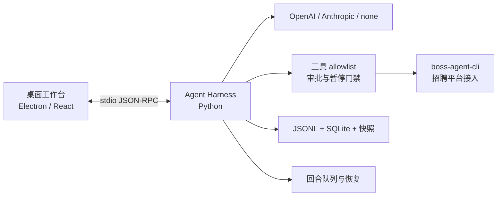

# BOSS Harness

<p align="center">
  <strong>面向招聘任务的 Agent Harness</strong><br>
  在桌面工作台里，把模型回合、招聘工具和可恢复会话连接成一条有边界的工作流。
</p>

<p align="center">
  <a href="https://github.com/can4hou6joeng4/boss-harness/actions/workflows/build.yml"></a>
  <a href="https://github.com/can4hou6joeng4/boss-harness/issues"></a>
  <a href="https://github.com/can4hou6joeng4/boss-harness/pulls"></a>
  <a href="https://github.com/can4hou6joeng4/boss-harness/stargazers"></a>
</p>

> `boss-agent-cli` 负责招聘平台接入；BOSS Harness 负责模型适配、执行循环、权限边界、会话状态和桌面交互。内核参考 Pi 的 Agent Harness / Durable 设计思想，但按本项目的招聘安全契约独立实现。

## 先找到你要的入口

| 你的目标 | 从这里开始 |
| --- | --- |
| 在本机跑起来并看一眼交互 | [快速开始](#快速开始) → [试跑一条任务](#试跑一条任务) |
| 了解搜索、队列、摘要和技能如何协作 | [工作方式](#工作方式) → [交互路径](#交互路径) |
| 配置 OpenAI、Anthropic 或无模型模式 | [模型与运行时配置](#模型与运行时配置) → [使用指南](docs/USER_GUIDE.md) |
| 评估查询范围、权限和隐私边界 | [安全边界](#安全边界) → [内核与业务契约参考](docs/TECHNICAL_REFERENCE.md) |
| 接入自定义工具或参与贡献 | [模块与扩展](#模块与扩展) → [贡献与验证](CONTRIBUTING.md) |

## 能力地图

| 你想解决的问题 | BOSS Harness 的做法 |
| --- | --- |
| 让模型帮我找职位 | 将自然语言转换为结构化条件，只查询明确的逻辑页，并保留来源和分页事实。 |
| 让任务持续推进 | 用串行工具批次、`steering`、`follow-up` 和持久队列管理消息进入回合的时机。 |
| 核对任务归属与恢复责任 | `task/read` 只读查询 turn、queue 或摘要任务的持久状态、当前执行 owner、恢复策略和已验证关系；不会恢复或重放任务。 |
| 避免招聘操作被重复执行 | 工具调用有稳定身份、逐次审批和结果未知边界；断连后先核对，不凭猜测重放。 |
| 让长会话可追溯 | 原始记录写入 append-only JSONL，SQLite 提供索引，冻结快照、摘要和分支都保留来源切点。 |
| 在不同模型线路间切换 | OpenAI Responses、Anthropic Messages 和 `none` 共享同一套回合与工具契约。 |
| 在桌面里观察过程 | Electron / React 工作台通过双向 stdio JSON-RPC 连接 Python 内核，显示回合、工具、队列和上下文状态。 |

当前内核提供 14 个 allowlist 工具：13 个只读工具，以及一个需要逐次审批的招聘者打招呼工具。能力发现不会自动增加工具权限；模型与普通 renderer 不接收平台 Cookie。

## 快速开始

### 环境要求

- Node.js 24+
- Python 3.12（内核声明支持 Python 3.10+；读取 TOML 配置需要 Python 3.11+）
- [`uv`](https://docs.astral.sh/uv/getting-started/installation/)
- macOS 12+（当前桌面端支持范围）

Electron 运行时会在安装时从官方源下载并校验，因此首次安装需要网络连接。当前仓库提供源码构建和 Python 内核构建；暂未提供独立安装包或签名发行流程。

### 安装、检查和启动

```sh
uv venv --python 3.12 .venv
uv pip install --python .venv/bin/python -e ./harness
npm ci
npx install-electron --no
npm run typecheck
npm run build
BOSS_HARNESS_PROVIDER=none npm run dev
```

`none` 会跳过模型调用，但 `/tools`、`/search`、`/status`、`/stats`、`/recommend`、`/jobs`、`/chat`、`/candidates` 仍会直接调用上游只读工具；未安装或未配置该 CLI 时这些命令不可用。真实模型请求可能联网并产生费用。

## 试跑一条任务

桌面启动并完成上游 CLI 配置后，可以按下面的顺序从只读入口开始：

1. 确保 `boss-agent-cli` 已安装，并按[上游 CLI 设置](docs/USER_GUIDE.md#上游-cli-设置)确认本项目能找到其可执行文件。
2. 输入 `/tools`，查看上游当前提供的能力目录；它不是本地授权清单，实际可调用范围仍受 Harness allowlist 限制。
3. 输入 `/search Python`，确认上游 CLI 和工作区连接正常。
4. 配置模型后输入：`上海 Python，20–50K，3–5 年，本科，先看第一页`。
5. 回合运行中发送新消息，选择转向当前回合，或将它排到当前回合结束后的队列。
6. 按 `⌘⇧K` 打开「运行状态」，核对内核线路、并发与保留回合、待审批调用、工具与模型目录；当前会话的队列摘要也在其中。面板打开时会随回合、审批与队列事件自动刷新，只展示本地内核返回的事实，当前版本不接入 MCP。运行中的回合与摘要任务可逐项核对 `task/read` 持久记录（状态、归属与恢复策略）；核对只读，不会恢复或重放任务。

<details>
<summary>展开：这条搜索请求经过了什么</summary>

```text
自然语言条件
    ↓
模型生成结构化 boss_search 参数
    ↓
Harness 校验条件、页码和工具权限
    ↓
boss-agent-cli 查询指定逻辑页
    ↓
桌面展示结果、来源与分页事实
    ↓
用户决定是否查看下一页或继续追问
```

系统不会自动翻页、放宽条件或补取职位详情。下一页需要保留原条件并明确提交新的页码。
</details>

## 工作方式



| 组件 | 负责什么 | 交互结果 |
| --- | --- | --- |
| Electron / React 工作台 | 输入、消息、工具详情、队列、设置和上下文面板 | 用户能看到任务处于哪个回合、是否排队以及是否需要处理暂停。 |
| Python Agent Harness | 模型流、工具编排、审批、超时、持久化和恢复 | 一次回合的事实按顺序写入，可在重启后继续读取。 |
| `boss-agent-cli` | 招聘平台的登录、搜索、沟通列表和平台状态 | Harness 只派发已声明的业务契约，不替上游猜测分页或认证事实。 |
| JSONL + SQLite | 正文、事件、索引和快照 | 原始记录保留，索引可重建，冷读和恢复有明确预算。 |

### 交互路径

- **搜索与沟通列表**：提交明确条件和页码；结果保留来源，未知分页和状态继续标为未知。
- **跨会话搜索**：`⌘K` 弹窗在输入至少 2 个字符后同时检索会话的标题、项目、消息正文与工具调用（工具名、有界参数与结果摘要，默认不含已归档），消息命中显示项目、会话名、角色（你 / 助手 / 工具）与命中片段，片段与会话标题中的关键词直接标出，点击可直接打开对应会话并滚动到该消息（短暂描边提示）；`↑` / `↓` 在同一条序列中依次选择消息命中与会话结果，`Enter` 打开当前项。消息分区可勾选「含已归档」，归档会话随之纳入消息与标题搜索，命中行标注「已归档」（内核声明 `threadSearchArchived` 时提供）。搜索有界（最多 100 个会话、50 条消息、单会话 5 条），损坏或过大的会话跳过，触顶时在消息分区标注「仅显示部分结果」。打开结果且查询至少 2 个字符时记入本地「最近搜索」（最多 5 条，可点击回填或一键清除，存储不可用时自动跳过）。旧内核未声明 `threadSearch` 时只按标题与项目搜索。
- **通知面板**：标题栏铃铛或 `⌘⇧A`（Windows / Linux 为 `Ctrl+Shift+A`）打开后读取内核 `approval/list`（最多 100 条），按内核顺序列出跨会话待审批的 `boss_hr_greet` 调用，并按会话分组（组标题显示「项目名 · 会话标题」与数量，不同项目下的同名会话可区分），行内显示工具名、摘要与到期提示（已过期 / 即将过期 / N 分钟后 / N 小时后）；点击条目打开对应会话并滚动定位到该审批卡（短暂描边提示），会话不在当前列表时标注不可点击；`↑` / `↓` 在可点击条目间循环移动焦点，`Home` / `End` 跳到首尾，`Enter` 打开当前条目。读取失败与「没有待审批」分开呈现，可重试或刷新；加载中显示读取状态。面板打开期间每 15 秒静默重读，新审批、已处理项与到期提示随之更新（页面隐藏时暂停，窗口聚焦时立即读取）；收到内核 `approval/requested` / `approval/decided` 通知后约 250 毫秒内再静默读取一次（连续事件合并），后台刷新失败保留当前列表。侧栏铃铛显示待审批数量（0 条隐藏、超过 9 条显示「9+」），连接内核后立即读取并每 30 秒刷新，收到内核 `approval/requested` / `approval/decided` 通知后约 250 毫秒内再读一次（连续事件合并），窗口重新获得焦点时也刷新，断开或示例模式下清除；读取失败保留上一次数量。窗口不在前台且系统支持通知时，内核 `approval/requested` 还会触发一条系统通知（标题为工具名、正文为该审批摘要），点击后恢复并聚焦工作台，并在定位字段齐全时直接打开对应会话、滚动到该审批卡（会话不在当前列表时只聚焦窗口）；同一 approvalId 只提醒一次，系统不支持或发送失败只影响提醒，不影响窗口内通知与审批流程。运行不少于 20 秒的回合结束时，同样会在窗口未聚焦时弹出系统通知（标题按完成 / 中断 / 暂停 / 出错区分，正文为运行时长），点击回到工作台；短回合与无法配对开始时间的回合不提醒。连接内核后待审批数量还会同步到应用图标徽标（系统支持时；归零或断开时清除）。设置 → 通知提供「发送测试通知」，经主进程确认系统支持后发送一条测试通知，并按返回值分别提示已请求展示、系统不支持或未能确认；设置 → 通知还可开启「审批提示音」（默认关闭）：新审批请求到达时播放两声短提示音，连续请求至少间隔 1.5 秒；不支持 Web Audio 或自动播放受限时静默跳过，不影响通知与列表刷新。
- **会话内审批**：聊天中的敏感操作审批卡在等待决定期间显示到期倒计时（取内核 `approval/requested` 事件与会话记录中的 `deadline`，内核以 Unix 秒返回，界面换算为毫秒后显示；每 15 秒刷新，文案为已过期 / 即将过期 / N 分钟后 / N 小时后）；剩余不足 5 分钟转警示色、到期转错误色，已处理后不再显示。到期时间缺失或不可读时不显示倒计时，不把未知时间标成正常；展示不影响审批决定与内核超时行为。仅渲染层实现，不新增 RPC。
- **会话内查找**：在聊天中按 `⌘F` / `Ctrl+F` 打开查找栏，按用户输入、模型段落与要点匹配当前消息（NFKC 归一化、不区分大小写），显示匹配数量，用 `Enter` / `Shift+Enter` 前后跳转并滚动到对应消息，`Esc` 关闭；空查询不选中任何消息。默认只匹配可见正文，勾选「含工具与思考」后还会匹配思考内容与工具调用的输入、结果、输出，切换后立即重算；命中的文字在消息中高亮，当前匹配使用另一种颜色，关闭查找即清除（浏览器不支持时退化为只保留消息描边）。
- **快速提问**：`⌘;`（Windows / Linux 为 `Ctrl+;`）或侧栏「快速提问」打开浮窗；已连接内核时，提问经既有 `thread/start` + `turn/start` 新建会话并立即发送，当前会话不受影响，成功后关闭浮窗并切换到新会话查看回复。创建或发送失败时保留输入并显示真实原因，不自动重试，也不在本地生成任何回复；线路按当前会话 → 进程默认线路 → 目录同 provider 条目解析，`none` 或解析不出时明确拒绝。仅浏览器预览模式保留标注为示例的演示。
- **正在运行的回合**：`steering` 在当前工具批次后、下一次模型请求前生效；`follow-up` 等当前回合自然结束后按 FIFO 排队。
- **失败可追溯**：回合以 `error` / `blocked` 结束时，原因码随回合记录持久化；重启或重新连接后，侧栏仍以红色状态点与「上次异常」标记该会话，悬停可查看原因码。
- **界面崩溃恢复**：主窗口渲染进程意外退出（崩溃、内存不足或被系统终止）时自动重新加载界面，120 秒内最多 2 次；连续失败后显示无脚本的静态诊断页，列出退出原因与退出码，并说明会话与回合记录保存在本地内核、重开应用可继续。正常退出不触发该恢复路径；界面加载失败仍走原有诊断页。协议与内核不变（仍为 `0.2.0`）。
- **待处理队列可见**：尚未形成回合的排队、投递中与暂停消息按会话汇总，侧栏以「队列 N」徽标显示数量；存在暂停项时改显警示色「暂停 N」，悬停可查看排队、投递中与暂停的分类数量。同一队列项按最新状态归并，已终结或撤回的消息不再计入，重启后仍能从会话记录恢复。队列项携带技能时，面板显示技能名称（目录缺失时回退 id），导出也会列出技能 id，便于在消息成为回合前核对。队列面板标题行提供「刷新」按钮，手动重读当前会话的 `queue/list` 并更新列表与总数 / 截断信息；刷新失败时显示原因并保留上一次内容，不显示成空队列。正文被截断（`inputTruncated`）的队列项另提供「查看完整输入」，经只读 `queue/get` 读取持久化正文并以模态展示，关闭不会重新提交或修改队列；读取失败时保留预览并显示原因。模态同时列出该项的技能与自动压缩覆盖，并提供「复制完整输入」，复制结果与失败原因如实显示。仍在排队（`queued`）的消息可在投递前编辑正文（需内核声明 `queueUpdate`）：编辑保留队列项 id、技能与压缩覆盖，被截断的正文会先读取完整输入再进入编辑器；已投递、投递中、暂停与已撤回的项不可编辑。本机内核断开时面板标注状态可能已过期并禁用刷新，恢复连接后由既有事件与重连流程重新读取。
- **待你处理**：侧栏顶部聚合上一回合异常、等待预检与存在暂停队列的会话，按最近更新排序，行内操作与其他分组一致；已归档或已隐藏的会话默认不出现，没有待处理会话时分组自动隐藏。
- **模型自动重试**：模型请求在首个输出前遇到瞬时失败时，会话区显示重试序号、倒计时与脱敏失败原因，并在恢复、失败或停止后给出结果；提示仅供观测，不提供重发入口。
- **导出会话**：内核支持时，可在聊天菜单「导出会话…」把当前分支或完整日志保存为 Markdown / JSON / 自包含 HTML，用于复盘与问题报告。默认脱敏：不导出凭据、令牌、环境变量、本机路径与附件内容，工具结果只保留调用名、执行状态与结构，个人信息按工具数据中识别到的字段值打码（未出现在工具数据中的姓名可能无法识别）；勾选「包含工具结果明文」需确认风险提示。HTML 内联样式、禁止脚本与外部资源，可直接用浏览器打开或打印。文件经系统保存对话框写入，超出上限时截断并标注。导出同时附带队列表状态：未形成回合的排队、投递中、暂停与已撤回消息（含暂停项的失败码与「输入是否已写入会话」，暂停项即使较早也优先保留），该状态与会话绑定，不受分支视图影响。用量来源字段（`provider` 与模型名）同样按默认规则脱敏，摘要任务明细会标注当前分支上生效的压缩摘要任务。
- **会话用量**：内核支持时，可在聊天菜单「会话用量」查看本会话合计、摘要任务与每回合的 provider 上报 token（输入、缓存读写、输出、推理）；每回合标注该回合实际使用的自动压缩策略与从开始到结束的用时（运行中显示「进行中」，时间缺失或非法时不显示），并显示该回合注入的技能 id（旧内核或没有技能时不显示），摘要任务可按任务查看来源、关联回合、触发原因与用量，压缩摘要另标注记录中覆盖到的回合，当前分支上验证通过并生效的压缩摘要任务标注「当前生效」。未上报的字段显示为「—」，不做估算，费用不计价。导出会话时同样附上摘要任务明细；压缩摘要与分支摘要条目还会标注来源任务编号（压缩摘要另附触发原因）。
- **会话内分支**：内核支持时，可在「会话分支」中查看分支端点、切换到其他分支或从已结束回合重新开始；原回合全部保留可切回，模型只看到当前分支。可选为被放弃分支生成摘要（会调用模型，默认关闭），摘要标注可展开查看模型生成的正文；运行、摘要或排队期间不可切换。
- **长会话**：可读取预算、规划并生成摘要、查看冻结快照，或从已结束回合创建分支；原始历史不因摘要被删除。会话上下文面板还可为下一条发送设置自动压缩覆盖（开关、触发阈值、保留目标），直接发送与「排到后续回合」的队列消息都会携带，发送后恢复默认，不写入会话；转向与续接消息不使用该覆盖。内核声明 `autoCompactionConfig` 时，设置 →「上下文」可查看并保存自动压缩的持久默认值：写入内核状态目录 `config.json`（原子替换、保留其他顶层键），重启后生效；`BOSS_HARNESS_COMPACTION` 显式设置时优先，此时界面只读并在保存请求上得到明确拒绝。`config/read` 的 `autoCompactionSource` 标明来源（`environment` / `stored` / `default` / `explicit`），策略中的摘要 provider、model、effort 仍由启动配置决定。队列读取同样有界：会话读取与 `queue/list` 返回全部待处理项和最近的已终结项，长正文只给预览，`queue/get` 按单项读取完整内容。
- **技能上下文**：从工作区 `.boss-harness/skills/<id>/SKILL.md`（旧 `.boss-cli/skills` 仍兼容读取） 选择技能，内容只作为该回合提示上下文，不执行目录脚本，也不扩大工具清单。内核声明 `skillsRead` 时，「技能与工具」页会列出工作区技能，并支持只读查看单个 `SKILL.md` 正文（最多 64 KiB，不写入会话）；目录未连接、加载中或读取失败会分别标注。页面同时显示当前生效的技能目录，来源为旧 `.boss-cli/skills` 时提示迁移；选中技能可直接预选进新会话草稿，不会自动发送。内核声明 `skillsCreate` 时还可新建技能：只创建不覆盖，写入当前生效目录；id 限定小写字母、数字、下划线与连字符，正文不超过 64 KiB，表单实时显示写入路径与字节计数。内核声明 `skillsWrite` 时还可编辑已有技能：保存必须携带读取时的摘要，文件被外部修改后拒绝覆盖并提示重新读取，草稿不会被自动重试。内核声明 `skillsDelete` 时还可二次确认后删除技能：只删除仅包含 `SKILL.md` 的技能目录，目录里还有脚本或素材时拒绝，摘要变化时不会删除任何内容。目录中无法安全读取的 `SKILL.md`（缺失、符号链接、超过 64 KiB、非 UTF-8 或不可读）会以「未能加载」列表显示原因，且不会进入技能列表或被注入。手工建立的旧技能目录名（如含大写、空格或中文）仍可查看、编辑与删除；新建技能继续使用严格 id。输入框技能菜单可按 id、名称与描述筛选，筛选不改变已选技能；已选技能还会在输入区以标签列出（悬停显示描述），可直接移除；已不在当前目录中的技能仍显示并标注不可用，不会静默丢弃。目录存在未能加载的技能时，菜单底部会显示数量并指向本页查看原因。页面本身也提供筛选，可按技能与未加载项定位，并显示匹配数量。回合记录已保存实际注入的技能 id，因此每个用户消息气泡下方会回显「本回合技能」（旧内核或旧会话没有该记录时不显示），点击标签可直接打开「技能与工具」并选中该技能；会话导出也会在回合信息中列出技能 id。
- **工作区常驻说明**：若工作区存在 `.boss-harness/CONTEXT.md`（旧 `.boss-cli/CONTEXT.md` 兼容），每回合组装系统提示时读取不超过 8 KiB 的 UTF-8 文本，用于城市、薪资、硬性技能等长期偏好；内容只是上下文，不改变工具权限、审批要求或只读限制，编辑后下一回合生效。会话上下文面板会显示该文件是否已加载、为空或已忽略（超限 / 不可读）；旧内核不返回该状态时不显示。内核声明 `workspaceInstructionsEdit` 时，面板可直接查看并保存该文件：UTF-8、不超过 8 KiB、拒绝符号链接，保存固定写入首选 `.boss-harness/CONTEXT.md`（旧位置仍生效时，保存后旧文件不再被读取），经临时文件原子替换，下一回合生效；保存不改变工具权限、审批要求或只读限制。「技能与工具」页也提供同一入口，不用先打开会话即可查看状态并编辑；编辑器与面板关闭时会提示未保存修改。
- **系统提示构成**：会话上下文面板显示本次请求系统提示的总字节数与分段明细（工具与运行说明、用户选择的技能、工作区说明、只读限制），分段与实际组装同源，只给规模不给正文；运行中的请求可能只显示总数，旧内核不返回该信息。
- **输入预算构成**：会话上下文面板在预算条下展示估算输入的去向（系统提示、消息历史、工具定义、选项），按比例分段并标注各项估算 token 数；应用历史用量校准时改显「历史用量基线 + 新增消息」，并说明基线已包含系统提示、工具与历史消息、无法再拆分。字段缺失、非法或全为 0 时不显示，估算不是账单。

## 安全边界

- 读取职位或沟通列表不会自动回复、投递、导出简历或翻页；招聘者打招呼需要逐次审批。
- 超时、断连或持久化异常可能使外部写操作处于结果未知状态；内核会暂停并要求先核对，不自动重放。
- 模型与普通 renderer 不接收平台 Cookie；业务 CLI 的认证、浏览器来源、缓存和网络重试仍由其自身契约决定。
- `none` 只表示不调用模型，不表示不调用招聘 CLI，也不代表不会访问平台。
- 代码交付授权不等于招聘平台操作授权；对外沟通、投递和批量操作需要用户明确授权。

首次运行建议使用临时工作区和只读工具。不要把凭据、Cookie 或真实招聘记录放入仓库、Issue、PR 或公开日志。

## 模型与运行时配置

桌面默认使用 OpenAI Responses，通过 `BOSS_HARNESS_PROVIDER` 可选择 `openai`、`anthropic` 或 `none`。

| 场景 | 配置入口 |
| --- | --- |
| OpenAI Responses | `BOSS_HARNESS_OPENAI_BASE_URL`、`BOSS_HARNESS_OPENAI_API_KEY`；模型由命令行 `--model`、`BOSS_HARNESS_MODEL`、`BOSS_HARNESS_OPENAI_MODEL` 或 Codex profile 提供。 |
| 本地 Codex profile | 显式 OpenAI 配置缺项时，依次读取 `BOSS_HARNESS_CODEX_CONFIG`、`CODEX_HOME/config.toml`、`~/.codex/config.toml`。 |
| Anthropic Messages | 使用 `ANTHROPIC_*` 环境变量；`BOSS_HARNESS_ANTHROPIC_MODEL` 可指定默认模型。 |
| 单次模型传输 | 默认总时限 600 秒；`BOSS_HARNESS_MODEL_REQUEST_TIMEOUT_SECONDS` 可设为 1–3600 秒。 |
| 招聘 CLI 可执行文件 | 按 `BOSS_CLI_BIN`、并排的 `boss-agent-cli/.venv/bin/boss`、PATH 顺序查找。 |
| 两类本地状态 | `BOSS_CLI_DATA_DIR` 管理上游登录/平台状态；`BOSS_HARNESS_DIR` 管理本项目会话（旧 `BOSS_CLI_HARNESS_DIR` 仍兼容）。 |
| steering 投递 | `BOSS_HARNESS_STEERING_MODE` 为 `all`（默认，每个投递点注入全部排队 steering）或 `one-at-a-time`（每次只注入最早一条）。 |
| 持久附件存储 | 默认最多 512 MiB、4096 个对象；`BOSS_HARNESS_MAX_ATTACHMENT_STORAGE_BYTES` 和 `BOSS_HARNESS_MAX_ATTACHMENT_STORAGE_OBJECTS` 可分别设置正整数上限，实际生效值可由 `config/read` 查询。 |

`BOSS_HARNESS_MODEL` 覆盖进程默认 provider 的模型；多 provider 目录中的其他线路使用对应的 `BOSS_HARNESS_OPENAI_MODEL` 或 `BOSS_HARNESS_ANTHROPIC_MODEL`。OpenAI 的端点、凭据和模型均显式配置齐全时不会读取 Codex profile；缺项时才按上表查找本地配置。

`model/list` 只列出本机已配置且当前可用的 provider/model，不探测远程目录，也不返回端点或凭据。`thread/start` 可为新会话选择 provider/model；空闲会话可通过 `thread/model/set` 切换到目录中的精确组合，选择会写入会话元数据并由 fork 继承。旧会话未记录 provider 时，仅当其模型属于进程默认线路才沿用，否则以 `MODEL_ROUTE_SELECTION_REQUIRED` 拒绝回合，需先 `thread/model/set` 选择线路；切换模型会清除不再适用的推理档位。活动回合、压缩、分支摘要进行中或仍有排队消息（`MODEL_SWITCH_QUEUE_PENDING`）时不可切换；fork 继承会话当前线路，而非来源回合当时的线路；来源回合之后切换过线路的中断回合不再允许续接。能力字段为 `capabilities.sessionModelSelection`。`turn/start.model` 只能覆盖为会话线路本身的模型 ID，跨线路模型以 `MODEL_ROUTE_MISMATCH` 拒绝而不改写；provider 由会话选择决定，大小写与 `codex` 别名以内核规范化为准。

完整的配置优先级、浏览器来源覆盖、职位筛选和沟通列表契约见[使用指南](docs/USER_GUIDE.md)。不要把 API key 或其他凭据写入仓库、配置样例或日志。

## 模块与扩展

内嵌 Python 应用可以通过 `ToolDefinition`、`ToolBundle` 和 `ApplicationService` 组合工具，或注入生命周期 hook。自定义工具仍须显式声明 schema、handler 和审批属性；任何外部或持久副作用都必须进入审批边界。默认招聘 bundle、平台登录能力和工具说明不会因为能力发现自动扩展。

需要评估请求预算、恢复、摘要、冷读、回合所有权或 JSON-RPC 契约时，请直接阅读[内核与业务契约参考](docs/TECHNICAL_REFERENCE.md)。

## 开发与验证

```sh
npm ci
npx install-electron --no
npm run typecheck
npm run build
python3 -m pip install build
python3 -m build ./harness
git diff --check
```

CI 会执行 npm 依赖审计、TypeScript 检查、Electron 源码构建及 Python wheel / sdist 构建。真实模型、招聘平台、桌面 UI 和已签名安装包需要分别验收；源码构建不代表这些场景已经通过。贡献时请遵循[贡献与验证](CONTRIBUTING.md)中的提交、PR 和发布约定。

## 项目导航

- [使用指南](docs/USER_GUIDE.md)：模型配置、请求期限、职位搜索、沟通列表、技能、队列和上游 CLI 设置。
- [内核与业务契约参考](docs/TECHNICAL_REFERENCE.md)：请求边界、失败恢复、上下文预算、资源上限和模块接口。
- [贡献与验证](CONTRIBUTING.md)：开发约定、提交格式、PR 与发布流程。
- [上游吸收记录](UPSTREAM.md)：Pi 等参考项目的来源、取舍和适配差异。
- [版本变化](CHANGELOG.md)：候选版本的功能、修复和验证范围。
- [Issues](https://github.com/can4hou6joeng4/boss-harness/issues) · [Pull requests](https://github.com/can4hou6joeng4/boss-harness/pulls)

当前源码版本为 `0.2.0-rc.14`；发布状态和构建结果以 GitHub 页面为准。
