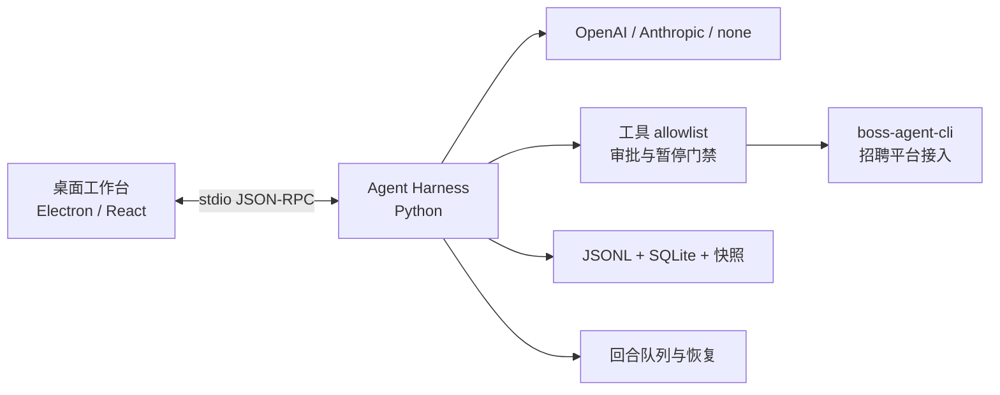

# BOSS-CLI

<p align="center">
  <strong>面向招聘任务的 Agent Harness</strong><br>
  在桌面工作台里，把模型回合、招聘工具和可恢复会话连接成一条有边界的工作流。
</p>

<p align="center">
  <a href="https://github.com/can4hou6joeng4/boss-cli/actions/workflows/build.yml"></a>
  <a href="https://github.com/can4hou6joeng4/boss-cli/issues"></a>
  <a href="https://github.com/can4hou6joeng4/boss-cli/pulls"></a>
  <a href="https://github.com/can4hou6joeng4/boss-cli/stargazers"></a>
</p>

> `boss-agent-cli` 负责招聘平台接入；BOSS-CLI 负责模型适配、执行循环、权限边界、会话状态和桌面交互。内核参考 Pi 的 Agent Harness / Durable 设计思想，但按本项目的招聘安全契约独立实现。

## 先找到你要的入口

| 你的目标 | 从这里开始 |
| --- | --- |
| 在本机跑起来并看一眼交互 | [快速开始](#快速开始) → [试跑一条任务](#试跑一条任务) |
| 了解搜索、队列、摘要和技能如何协作 | [工作方式](#工作方式) → [交互路径](#交互路径) |
| 配置 OpenAI、Anthropic 或无模型模式 | [模型与运行时配置](#模型与运行时配置) → [使用指南](docs/USER_GUIDE.md) |
| 评估查询范围、权限和隐私边界 | [安全边界](#安全边界) → [内核与业务契约参考](docs/TECHNICAL_REFERENCE.md) |
| 接入自定义工具或参与贡献 | [模块与扩展](#模块与扩展) → [贡献与验证](CONTRIBUTING.md) |

## 能力地图

| 你想解决的问题 | BOSS-CLI 的做法 |
| --- | --- |
| 让模型帮我找职位 | 将自然语言转换为结构化条件，只查询明确的逻辑页，并保留来源和分页事实。 |
| 让任务持续推进 | 用串行工具批次、`steering`、`follow-up` 和持久队列管理消息进入回合的时机。 |
| 核对任务归属与恢复责任 | `task/read` 只读查询 turn、queue 或摘要任务的持久状态、当前执行 owner、恢复策略和已验证关系；不会恢复或重放任务。 |
| 避免招聘操作被重复执行 | 工具调用有稳定身份、逐次审批和结果未知边界；断连后先核对，不凭猜测重放。 |
| 让长会话可追溯 | 原始记录写入 append-only JSONL，SQLite 提供索引，冻结快照、摘要和分支都保留来源切点。 |
| 在不同模型线路间切换 | OpenAI Responses、Anthropic Messages 和 `none` 共享同一套回合与工具契约。 |
| 在桌面里观察过程 | Electron / React 工作台通过双向 stdio JSON-RPC 连接 Python 内核，显示回合、工具、队列和上下文状态。 |

当前内核提供 14 个 allowlist 工具：13 个只读工具，以及一个需要逐次审批的招聘者打招呼工具。能力发现不会自动增加工具权限；模型与普通 renderer 不接收平台 Cookie。

## 快速开始

### 环境要求

- Node.js 24+
- Python 3.12（内核声明支持 Python 3.10+；读取 TOML 配置需要 Python 3.11+）
- [`uv`](https://docs.astral.sh/uv/getting-started/installation/)
- macOS 12+（当前桌面端支持范围）

Electron 运行时会在安装时从官方源下载并校验，因此首次安装需要网络连接。当前仓库提供源码构建和 Python 内核构建；暂未提供独立安装包或签名发行流程。

### 安装、检查和启动

```sh
uv venv --python 3.12 .venv
uv pip install --python .venv/bin/python -e ./harness
npm ci
npx install-electron --no
npm run typecheck
npm run build
BOSS_HARNESS_PROVIDER=none npm run dev
```

`none` 会跳过模型调用，但输入 `/tools` 或 `/search` 仍会尝试调用上游 `boss-agent-cli`；未安装或未配置该 CLI 时，这两个命令不可用。真实模型请求可能联网并产生费用。

## 试跑一条任务

桌面启动并完成上游 CLI 配置后，可以按下面的顺序从只读入口开始：

1. 确保 `boss-agent-cli` 已安装，并按[上游 CLI 设置](docs/USER_GUIDE.md#上游-cli-设置)确认本项目能找到其可执行文件。
2. 输入 `/tools`，查看上游当前提供的能力目录；它不是本地授权清单，实际可调用范围仍受 Harness allowlist 限制。
3. 输入 `/search Python`，确认上游 CLI 和工作区连接正常。
4. 配置模型后输入：`上海 Python，20–50K，3–5 年，本科，先看第一页`。
5. 回合运行中发送新消息，选择转向当前回合，或将它排到当前回合结束后的队列。

<details>
<summary>展开：这条搜索请求经过了什么</summary>

```text
自然语言条件
    ↓
模型生成结构化 boss_search 参数
    ↓
Harness 校验条件、页码和工具权限
    ↓
boss-agent-cli 查询指定逻辑页
    ↓
桌面展示结果、来源与分页事实
    ↓
用户决定是否查看下一页或继续追问
```

系统不会自动翻页、放宽条件或补取职位详情。下一页需要保留原条件并明确提交新的页码。
</details>

## 工作方式



| 组件 | 负责什么 | 交互结果 |
| --- | --- | --- |
| Electron / React 工作台 | 输入、消息、工具详情、队列、设置和上下文面板 | 用户能看到任务处于哪个回合、是否排队以及是否需要处理暂停。 |
| Python Agent Harness | 模型流、工具编排、审批、超时、持久化和恢复 | 一次回合的事实按顺序写入，可在重启后继续读取。 |
| `boss-agent-cli` | 招聘平台的登录、搜索、沟通列表和平台状态 | Harness 只派发已声明的业务契约，不替上游猜测分页或认证事实。 |
| JSONL + SQLite | 正文、事件、索引和快照 | 原始记录保留，索引可重建，冷读和恢复有明确预算。 |

### 交互路径

- **搜索与沟通列表**：提交明确条件和页码；结果保留来源，未知分页和状态继续标为未知。
- **正在运行的回合**：`steering` 在当前工具批次后、下一次模型请求前生效；`follow-up` 等当前回合自然结束后按 FIFO 排队。
- **长会话**：可读取预算、规划并生成摘要、查看冻结快照，或从已结束回合创建分支；原始历史不因摘要被删除。
- **技能上下文**：从工作区 `.boss-cli/skills/<id>/SKILL.md` 选择技能，内容只作为该回合提示上下文，不执行目录脚本，也不扩大工具清单。

## 安全边界

- 读取职位或沟通列表不会自动回复、投递、导出简历或翻页；招聘者打招呼需要逐次审批。
- 超时、断连或持久化异常可能使外部写操作处于结果未知状态；内核会暂停并要求先核对，不自动重放。
- 模型与普通 renderer 不接收平台 Cookie；业务 CLI 的认证、浏览器来源、缓存和网络重试仍由其自身契约决定。
- `none` 只表示不调用模型，不表示不调用招聘 CLI，也不代表不会访问平台。
- 代码交付授权不等于招聘平台操作授权；对外沟通、投递和批量操作需要用户明确授权。

首次运行建议使用临时工作区和只读工具。不要把凭据、Cookie 或真实招聘记录放入仓库、Issue、PR 或公开日志。

## 模型与运行时配置

桌面默认使用 OpenAI Responses，通过 `BOSS_HARNESS_PROVIDER` 可选择 `openai`、`anthropic` 或 `none`。

| 场景 | 配置入口 |
| --- | --- |
| OpenAI Responses | `BOSS_HARNESS_OPENAI_BASE_URL`、`BOSS_HARNESS_OPENAI_API_KEY`；模型由命令行 `--model`、`BOSS_HARNESS_MODEL`、`BOSS_HARNESS_OPENAI_MODEL` 或 Codex profile 提供。 |
| 本地 Codex profile | 显式 OpenAI 配置缺项时，依次读取 `BOSS_HARNESS_CODEX_CONFIG`、`CODEX_HOME/config.toml`、`~/.codex/config.toml`。 |
| Anthropic Messages | 使用 `ANTHROPIC_*` 环境变量；`BOSS_HARNESS_ANTHROPIC_MODEL` 可指定默认模型。 |
| 单次模型传输 | 默认总时限 600 秒；`BOSS_HARNESS_MODEL_REQUEST_TIMEOUT_SECONDS` 可设为 1–3600 秒。 |
| 招聘 CLI 可执行文件 | 按 `BOSS_CLI_BIN`、并排的 `boss-agent-cli/.venv/bin/boss`、PATH 顺序查找。 |
| 两类本地状态 | `BOSS_CLI_DATA_DIR` 管理上游登录/平台状态；`BOSS_CLI_HARNESS_DIR` 管理本项目会话。 |

`BOSS_HARNESS_MODEL` 覆盖进程默认 provider 的模型；多 provider 目录中的其他线路使用对应的 `BOSS_HARNESS_OPENAI_MODEL` 或 `BOSS_HARNESS_ANTHROPIC_MODEL`。OpenAI 的端点、凭据和模型均显式配置齐全时不会读取 Codex profile；缺项时才按上表查找本地配置。

`model/list` 只列出本机已配置且当前可用的 provider/model，不探测远程目录，也不返回端点或凭据。`thread/start` 可为新会话选择 provider/model；空闲会话可通过 `thread/model/set` 切换到目录中的精确组合，选择会写入会话元数据并由 fork 继承。旧会话未记录 provider 时继续使用进程默认线路；切换模型会清除不再适用的推理档位。`turn/start.model` 仍可只覆盖单回合的模型 ID，provider 仍由会话选择决定，不会随单回合覆盖而切换。

完整的配置优先级、浏览器来源覆盖、职位筛选和沟通列表契约见[使用指南](docs/USER_GUIDE.md)。不要把 API key 或其他凭据写入仓库、配置样例或日志。

## 模块与扩展

内嵌 Python 应用可以通过 `ToolDefinition`、`ToolBundle` 和 `ApplicationService` 组合工具，或注入生命周期 hook。自定义工具仍须显式声明 schema、handler 和审批属性；任何外部或持久副作用都必须进入审批边界。默认招聘 bundle、平台登录能力和工具说明不会因为能力发现自动扩展。

需要评估请求预算、恢复、摘要、冷读、回合所有权或 JSON-RPC 契约时，请直接阅读[内核与业务契约参考](docs/TECHNICAL_REFERENCE.md)。

## 开发与验证

```sh
npm ci
npx install-electron --no
npm run typecheck
npm run build
python3 -m pip install build
python3 -m build ./harness
git diff --check
```

CI 会执行 npm 依赖审计、TypeScript 检查、Electron 源码构建及 Python wheel / sdist 构建。真实模型、招聘平台、桌面 UI 和已签名安装包需要分别验收；源码构建不代表这些场景已经通过。贡献时请遵循[贡献与验证](CONTRIBUTING.md)中的提交、PR 和发布约定。

## 项目导航

- [使用指南](docs/USER_GUIDE.md)：模型配置、请求期限、职位搜索、沟通列表、技能、队列和上游 CLI 设置。
- [内核与业务契约参考](docs/TECHNICAL_REFERENCE.md)：请求边界、失败恢复、上下文预算、资源上限和模块接口。
- [贡献与验证](CONTRIBUTING.md)：开发约定、提交格式、PR 与发布流程。
- [上游吸收记录](UPSTREAM.md)：Pi 等参考项目的来源、取舍和适配差异。
- [版本变化](CHANGELOG.md)：候选版本的功能、修复和验证范围。
- [Issues](https://github.com/can4hou6joeng4/boss-cli/issues) · [Pull requests](https://github.com/can4hou6joeng4/boss-cli/pulls)

当前源码版本为 `0.2.0-rc.14`；发布状态和构建结果以 GitHub 页面为准。
