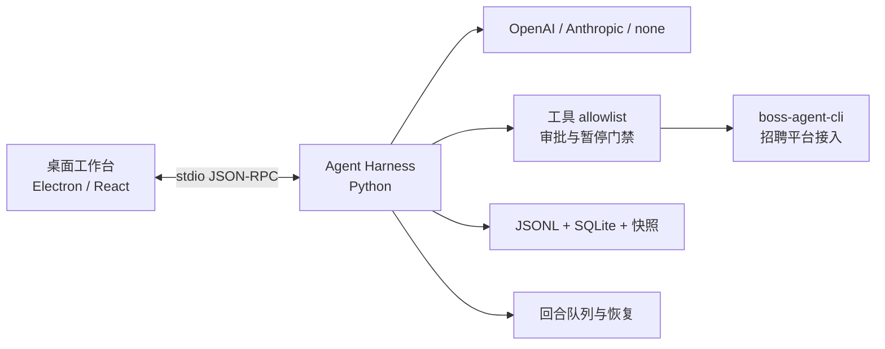

# BOSS-CLI

<p align="center">
  <strong>面向招聘任务的 Agent Harness</strong><br>
  用可控的模型回合、招聘工具与可恢复会话，完成有边界的招聘工作流。
</p>

<p align="center">
  <a href="https://github.com/can4hou6joeng4/boss-cli/actions/workflows/build.yml"></a>
  <a href="https://github.com/can4hou6joeng4/boss-cli/issues"></a>
  <a href="https://github.com/can4hou6joeng4/boss-cli/pulls"></a>
  <a href="https://github.com/can4hou6joeng4/boss-cli/stargazers"></a>
</p>

> `boss-agent-cli` 负责招聘平台接入；BOSS-CLI 负责模型适配、执行循环、权限边界、会话状态和桌面交互。内核借鉴 Pi 的 Agent Harness / Durable 设计思想，按本项目的招聘安全契约独立实现。

**快速导航**　[快速开始](#快速开始) · [试一次](#试一次) · [工作方式](#工作方式) · [安全边界](#安全边界) · [配置与开发](#配置与开发)

## 快速开始

需要 Node.js 24+、Python 3.12 和 [uv](https://docs.astral.sh/uv/getting-started/installation/)。桌面端最低支持 macOS 12；内核本身声明支持 Python 3.10+。Electron 运行时会在安装时从官方源下载并校验，需要网络连接。模型线路和搜索筛选的配置细节见[使用指南](docs/USER_GUIDE.md)。

```sh
uv venv --python 3.12 .venv
uv pip install --python .venv/bin/python -e ./harness
npm ci
npx install-electron --no
npm run typecheck
npm run build
BOSS_HARNESS_PROVIDER=none npm run dev
```

`npm run build` 生成 Electron main、preload 和 renderer 源码构建产物；仓库目前没有独立安装包或签名发行流程。

## 试一次

桌面启动后，可以先在不请求模型的模式里检查交互：

1. 输入 `/tools`，查看当前允许的工具。
2. 配好 `boss-agent-cli` 后输入 `/search Python`，查看关键词搜索结果。
3. 配置模型后尝试：“上海 Python，20–50K，3–5 年，本科，先看第一页”。
4. 回合运行中发送新消息，选择转向当前回合，或排到后续回合。

`none` 只表示不调用模型；`/tools` 和 `/search` 仍可能调用配置的招聘 CLI。

<details>
<summary>展开一次职位查询的处理路径</summary>

```text
自然语言条件
    ↓
模型生成结构化搜索参数
    ↓
Harness 校验参数、页码和工具权限
    ↓
boss-agent-cli 查询指定逻辑页
    ↓
桌面展示结果与来源，用户决定下一步
```

系统不会自动翻页、放宽搜索条件或补取职位详情。
</details>

## 工作方式

| 你要做的事 | 交互方式 |
| --- | --- |
| 搜索职位或查看沟通列表 | 提交明确条件和页码；结果保留来源与分页状态。 |
| 调整正在进行的任务 | `steering` 在当前工具批次后生效；`follow-up` 等当前回合结束后排队执行。 |
| 管理较长的会话 | 原始记录保存在 append-only JSONL，SQLite 提供索引；可检查上下文预算、生成摘要并恢复会话。 |
| 扩展当前回合的指引 | 从工作区选择技能文件作为提示上下文，不会因此增加工具权限。 |



模型适配、会话编排和桌面交互属于本仓库；招聘平台能力由单独配置的 `boss-agent-cli` 提供。

## 安全边界

- 当前内核提供 14 个 allowlist 工具：13 个只读工具，招聘者打招呼工具需要逐次审批。
- 读取列表不会自动回复、投递、导出简历或翻页；能力发现不会自动开放新权限。
- 超时或断连后，外部写操作可能处于结果未知状态；系统要求先核对，不会凭猜测重放。
- 模型与普通 renderer 不接收平台 Cookie。真实模型请求可能联网并产生费用。
- 代码交付不等于招聘平台操作授权；对外沟通、投递和批量操作需要用户明确授权。

首次运行建议使用临时工作区和只读工具。不要把凭据、Cookie 或真实招聘记录放入仓库、Issue、PR 或公开日志。

## 配置与开发

<details>
<summary>展开模型配置来源</summary>

桌面默认使用 OpenAI Responses。通过 `BOSS_HARNESS_PROVIDER` 选择 `openai`、`anthropic` 或 `none`。

| 模型线路 | 配置 |
| --- | --- |
| OpenAI Responses | 显式配置 `BOSS_HARNESS_OPENAI_BASE_URL`、`BOSS_HARNESS_OPENAI_API_KEY`，模型取命令行 `--model`，其次为 `BOSS_HARNESS_MODEL`。 |
| 本地 Codex profile | 显式 OpenAI 配置缺项时，读取 `BOSS_HARNESS_CODEX_CONFIG`、`CODEX_HOME/config.toml` 或 `~/.codex/config.toml`。读取 TOML 需要 Python 3.11+。 |
| Anthropic Messages | 使用 `ANTHROPIC_*` 环境变量。 |
| 无模型模式 | 设置 `BOSS_HARNESS_PROVIDER=none`；模型不会被调用，但招聘 CLI 工具仍可运行。 |

所有凭据都应保存在本地环境或安全的凭据管理工具中，不要写进配置样例、提交或日志。
</details>

<details>
<summary>展开验证命令</summary>

```sh
npm ci
npx install-electron --no
npm run typecheck
npm run build
python3 -m pip install build
python3 -m build ./harness
git diff --check
```

CI 会运行 npm 依赖审计、类型检查、桌面构建及 Python wheel / sdist 构建。真实模型、招聘平台和已签名安装包需要分别验收，源码构建不代表这些场景已经通过。
</details>

## 项目导航

- [使用指南](docs/USER_GUIDE.md)：模型配置、职位搜索、沟通列表、技能与任务队列。
- [内核与业务契约参考](docs/TECHNICAL_REFERENCE.md)：请求边界、恢复流程、上下文预算和模块接口。
- [贡献与验证](CONTRIBUTING.md)：开发约定、提交格式、PR 和发布流程。
- [上游吸收记录](UPSTREAM.md)：Pi 等参考项目的来源与适配差异。
- [版本变化](CHANGELOG.md)：各候选版本的功能与修复。
- [Issues](https://github.com/can4hou6joeng4/boss-cli/issues) · [Pull requests](https://github.com/can4hou6joeng4/boss-cli/pulls)
